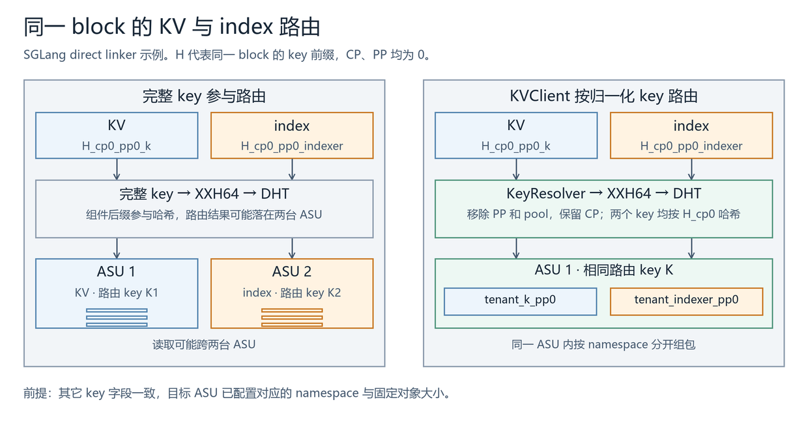

# KVClient namespace 切批与结果回填

**一个 KVClient 请求可访问多个 namespace，每个 ASU 协议请求携带一个 namespace ID。** Client 在 DHT 路由后按 **ASU + namespace** 建立传输任务。IoScheduler 对各任务独立切批，完成后按原始输入顺序返回结果。

1. **解析 key。** Query / Delete 接收 `CacheKey`，Load / Store 接收 `KVBuffer`。内部条目分别为 `ResolvedCacheKey` 和 `ResolvedKVBuffer`，由 `ResolvedCacheKey` 保存 8 字节 key 和 namespace ID。

   | 输入 | 8 字节 key | Namespace ID |
   | --- | --- | --- |
   | 字符串 key | vLLM-Ascend 提取 `@group:<rank>`、`@pp_rank:<rank>`。SGLang direct linker 从 `_cp<rank>_pp<rank>_<pool>` 提取 PP 和 pool，保留 CP。其余字段参与 XXH64，结果按小端编码 | 将实际出现的 group 或 pool、PP 追加到基础租户名 `IoOptions::kvns`，对生成的名称做 XXH32，得到 GNSID |
   | 二进制 key | 保留输入的 8 字节 | 使用初始化时从第一份 ASU 传输配置读取的 `kv_ns_id`，缺省为 0。同一客户端的 ASU 配置应一致 |

   两种哈希的 seed 均为 5381。字符串 key 对应的 namespace 需在 ASU 上预先创建，并按实际布局配置固定对象大小。

2. **DHT 路由 → 创建 TransportTask。** DHT 使用 8 字节 key 选择 ASU。Client 遍历每台 ASU 的路由结果，用 namespace ID 查找或创建对应的 `TransportTask`，把条目直接移入任务 vector，并把输入下标写入 `originalIndices`。分组不搬动 HBM 数据。
3. **切批 → 组包。** IoScheduler 通过 `SplitBatchView` 按协议条目上限切分任务内的连续条目。各子批次从任务继承 `namespaceId`，组包时写入 SQE 的 `kv_ns_id`。当前字符串路径直接使用 GNSID，二进制路径直接使用配置 ID。GNSID 到 LocalNSID 的视图映射尚未接入。
4. **子批结果 → TransportTask → ClientTask。** 传输层按子批原有顺序汇总任务内结果。每个 TransportTask 完成时，Client 用 `originalIndices` 回填逐项状态和 Query 命中结果。全部 TransportTask 收敛后完成父任务，`Wait` 取得最终结果；调用方等待超时可提前返回，逐项结果可能尚未填齐。

[Excalidraw](KVClient_Namespace切批与结果回填.excalidraw) · [SVG](KVClient_Namespace切批与结果回填.svg)

同一 block 的 KV 与 index 在剩余 key 字段一致时，使用相同的 8 字节 key 路由到同一台 ASU，再通过不同 namespace 区分对象。这样可以减少跨 ASU 的读取扇出，各 namespace 仍分别组包。

[Excalidraw](同Block跨Namespace路由_问题与方案.excalidraw) · [SVG](同Block跨Namespace路由_问题与方案.svg)

实现基线：[PR #1641](https://github.com/ModelEngine-Group/unified-cache-management/pull/1641)（`d2a7efa5`） · [PR #1708](https://github.com/ModelEngine-Group/unified-cache-management/pull/1708)（`c2eb5205`）
