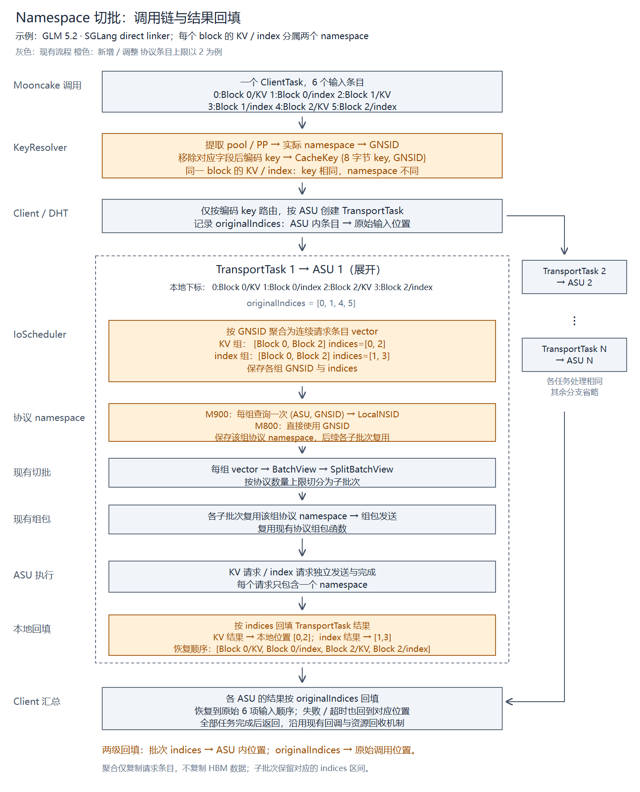

# KVClient namespace 切批与结果回填

**一个 KVClient 任务可以包含多个 namespace；一个 ASU 协议请求只能包含一个 namespace。** 按 ASU 路由后，先按 GNSID 聚合请求条目（Exists / Delete ： `CacheKey`，Load / Store ： `KVBuffer`），每组确定一次协议 namespace，再调用 `SplitBatchView` 切批，完成后恢复输入顺序。

```text
Mooncake 批量调用：key + baseKvns
    │
    ▼
KeyResolver 〔新增〕
    提取 group/pool、PP → 实际 namespace → GNSID
    从 key 移除对应字段 → 编码为 8 字节 key
    输出 CacheKey {key, GNSID}
    │
    ▼
Client / DHT
    仅按 key 路由 → 每个 ASU 一个 TransportTask
    保存 originalIndices：ASU 内位置 → 原始输入位置
    │
    ▼
IoScheduler：按 namespace 聚合 〔新增〕
    按 GNSID 聚合：每组保存连续请求条目 vector + indices
    │
    ▼
确定协议 namespace 〔新增〕
    M900：每组通过 (ASU, GNSID) 查询一次 LocalNSID
    M800：直接使用 GNSID
    保存该组协议 namespace，后续各子批次复用
    │
    ▼
现有切批
    每组创建 BatchView → SplitBatchView 按协议数量上限切批
    │
    ▼
现有组包 → ASU 执行
    各子批次复用该组协议 namespace，每个子批次一个请求
    │
    ▼
TransportTask 结果回填 〔调整〕
    按 indices 恢复 ASU 内条目顺序
    │
    ▼
Client 结果回填
    按 originalIndices 恢复原始输入顺序 → 完成回调
```

**示例：GLM 5.2 的 KV 与 index，只有 ASU 1 的处理展开；其余任务流程相同。** 灰色为现有流程或设备前提，橙色为新增或调整。



[Excalidraw](KVClient_Namespace切批与结果回填.excalidraw) · [SVG](KVClient_Namespace切批与结果回填.svg)

- **namespace：** vLLM 提取 group/PP，SGLang 提取 pool/PP；仅追加实际存在的字段。用户提前创建 namespace，并配置固定对象大小。key 使用 XXH64，GNSID 使用 XXH32，seed 均为 5381。
- **聚合与切批：** 先维护 `GNSID → 请求条目组`，将同 namespace 的条目收集到连续 vector；再复用 `SplitBatchView` 按协议数量上限切分各组。不跨任务凑批，只复制请求条目，不复制 HBM 数据。
- **回填：** 每组的 `indices` 记录条目在 TransportTask 中的位置；子批次使用与其条目区间对应的 indices 回填。Client 再按 `originalIndices` 恢复原始输入顺序；乱序完成、失败和超时均回到对应位置。
- **设备视图：** M900 初始化时保存 `(ASU, GNSID) → LocalNSID` 视图，后续可刷新；聚合后每组查询一次，各子批次复用所得 LocalNSID，避免重复查视图。查询失败则该组条目返回错误，不继续切批发送。M800 不做映射，协议 namespace 直接使用 GNSID。

同一 block 的不同组件保留相同路由 key，通过 namespace 区分对象，减少跨 ASU 读取扇出：


[编辑路由图（Excalidraw）](同Block跨Namespace路由_问题与方案.excalidraw)

基线：PR #1641 `f3e601f5`；新增和调整部分为待实现方案。
