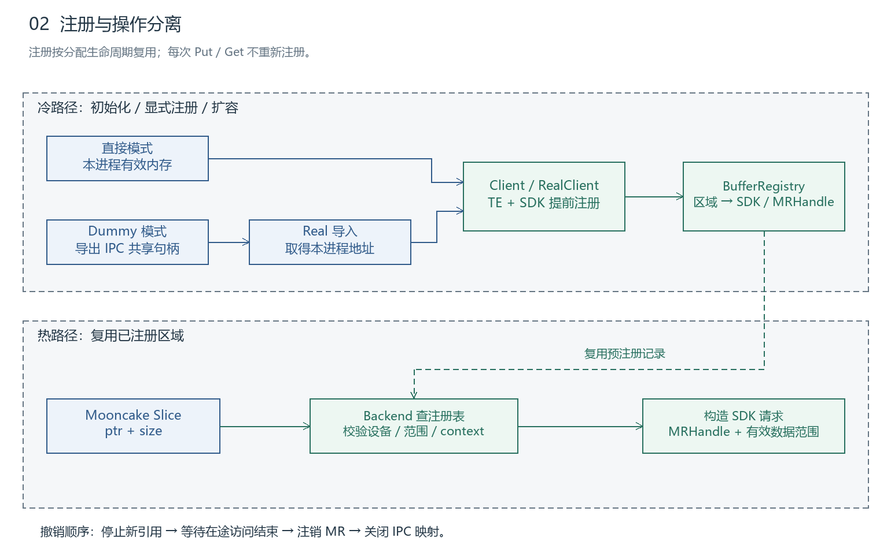
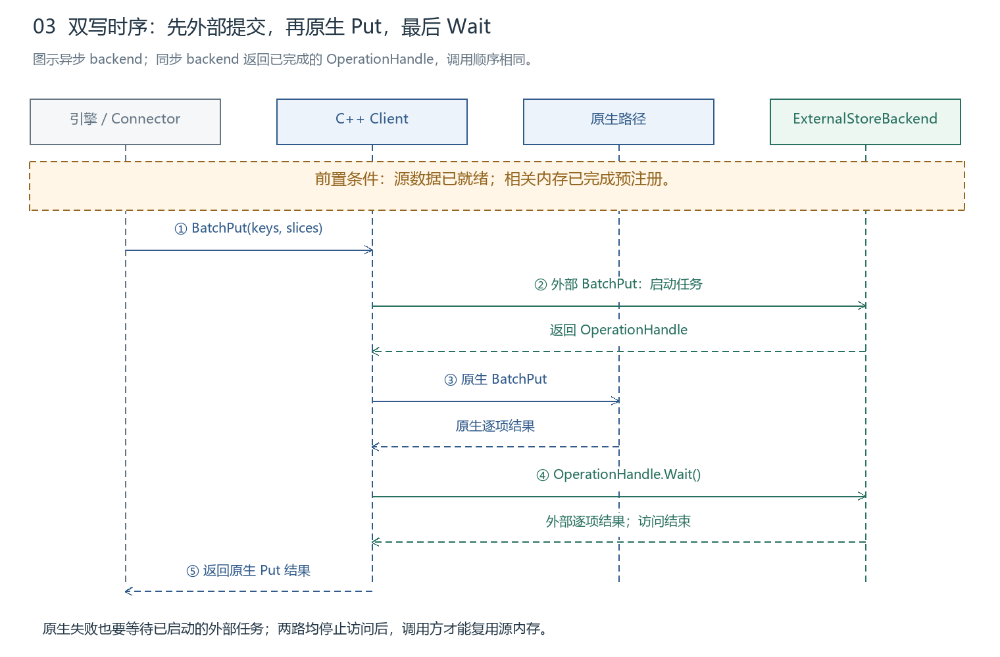
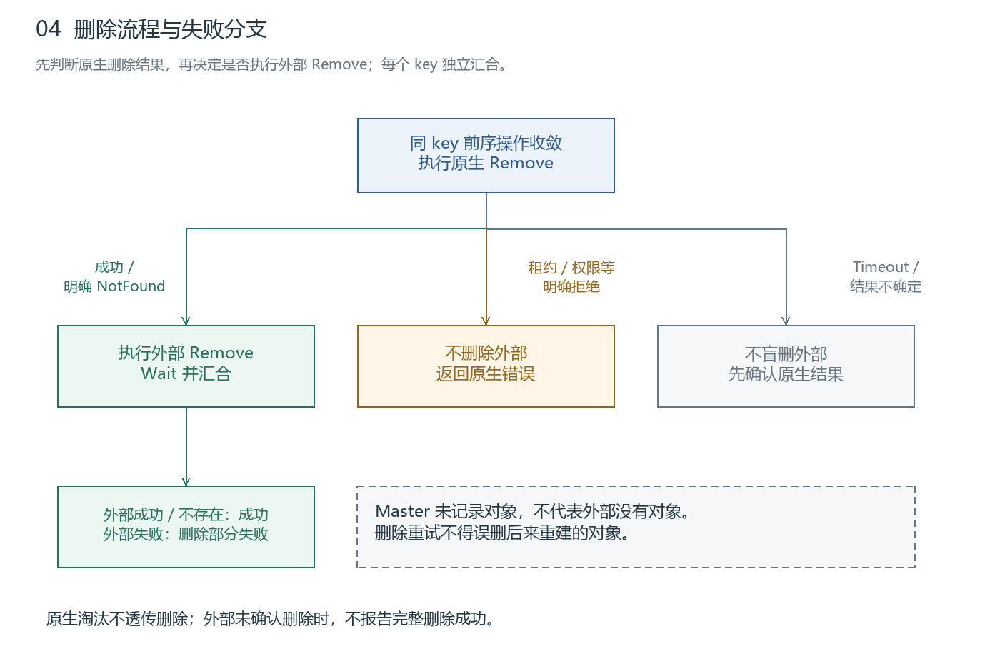

# Mooncake 接入 KVClient 双写&delete 模块设计

**版本：v4｜日期：2026-10-22｜状态：模块设计评审**

ExternalStoreBackend 为 Mooncake 提供外部对象存储访问能力，KVClientBackend 封装完整 KVClient SDK。模块负责内存注册、双写编排和显式删除。接口声明见 [external_storage_backend_v3.h](external_storage_backend_v3.h)。

## 1. 背景与需求分析

Mooncake 原生内存副本淘汰后，外部缓存仍可保留 KVCache，降低重新计算开销。Store 通过 KVClientBackend 调用完整 KVClient SDK，原生副本继续使用 Master 与 TE。

| 需求 | 设计约束 |
| --- | --- |
| 双写内存与外部存储 | 外部先提交，原生同步 Put，最后 Wait 外部结果 |
| 保留原生 Put 语义 | 外部失败不覆盖原生 Put 结果；返回前两路均停止访问源 |
| 外部独立保留缓存 | 不向 Master 逐项登记外部对象；原生淘汰不删除外部 |
| 显式删除覆盖两端 | Master 明确不存在仍删除外部；条件拒绝不能绕过 |
| 后续接入其他 backend | 公共接口不暴露 SDK TaskId、MRHandle 或设备协议 |
| 设备内存直通 | 预注册并复用；不新增 payload gather/staging，不越界访问 |


*图 1：Client 编排两条路径，KVClientBackend 实现 ExternalStoreBackend。[Excalidraw](assets/01-architecture.excalidraw)*

| 模块 | 职责 |
| --- | --- |
| C++ Client | 公共双写/删除流程、同 key 本地排序、结果汇合 |
| RealClient | 公共入口适配、IPC 导入与地址转换 |
| KVClientBackend | key/slices 转换、注册表查找、SDK 任务封装 |
| 完整 KVClient SDK | DHT、节点分组、协议、连接、注册与完成汇总 |

同 key 内容不可变。本模块定义写入、删除与注册接口；查询和读取接口由读侧模块负责，相关协作约束见第 4、5 节。

## 2. ExternalStoreBackend 接口设计


```cpp
class ExternalStoreBackend {
public:
    virtual ~ExternalStoreBackend() = default;

    virtual tl::expected<std::unique_ptr<OperationHandle>, ErrorCode> Put(
        const ObjectKey& key, const std::vector<Slice>& slices) = 0;

    virtual tl::expected<std::unique_ptr<OperationHandle>, ErrorCode> BatchPut(
        const std::vector<ObjectKey>& keys,
        const std::vector<std::vector<Slice>>& batched_slices) = 0;

    virtual tl::expected<std::unique_ptr<OperationHandle>, ErrorCode> Remove(
        const ObjectKey& key) = 0;

    virtual tl::expected<std::unique_ptr<OperationHandle>, ErrorCode> BatchRemove(
        const std::vector<ObjectKey>& keys) = 0;

    virtual tl::expected<void, ErrorCode> RegisterRegions(
        const std::vector<MemoryRegion>& regions,
        std::vector<std::shared_ptr<const StorageBuffer>>& registered_regions) = 0;

    virtual tl::expected<void, ErrorCode> UnregisterRegions(
        const std::vector<std::shared_ptr<const StorageBuffer>>& regions) = 0;
};
```

对象操作返回 OperationHandle，KVClientBackend 异步完成，其他 backend 可以同步完成。Put、BatchPut、Remove、BatchRemove 分别由具体 backend 实现。

ObjectKey、Slice、ErrorCode 复用 Mooncake 类型。`keys[i] ↔ batched_slices[i]`，内层 slices 按序组成一个对象；长度检查求和。backend 保存异步任务所需的描述，不能修改原生路径的描述容器，也不复制 payload。

```cpp
class OperationHandle {
public:
    virtual ~OperationHandle() = default;
    virtual bool IsReady() const = 0;
    virtual std::vector<tl::expected<void, ErrorCode>> Wait() = 0;
};
```

| backend 类型 | OperationHandle 实现 |
| --- | --- |
| KVClient | 内部持有 SDK context、TaskId、原下标映射和结果 |
| DPU 等其他实现 | 可用回调或自身完成状态，不要求数字 TaskId |
| 同步 backend | 返回已完成句柄；Wait 立即返回 |

**提交结果与执行结果分离：** 提交 expected 有值表示获得可追踪句柄；Wait 才给出逐项结果。部分请求已派发时必须返回句柄，不能只返回错误而遗失在途任务。结果数量/顺序与输入一致。

Put/Remove 的逐项结果只表达成功或 ErrorCode，成功无附加字段。IsReady 表示完成，不代表成功。Wait 的超时、取消和析构契约尚未确定，影响同步返回后的内存安全，见第 5 节。读侧结果结构由读侧模块定义。

## 3. 关键流程

### 3.1 初始化

注册资源随内存分配或 IPC 导入建立，并在多次 Put/Get 间复用。



*图 2：直接模式与 Dummy/Real 在注册阶段归一，Put/Get 只复用记录。[Excalidraw](assets/02-registration.excalidraw)*

| 阶段 | 动作 | 失败处理 |
| --- | --- | --- |
| 创建 backend | 初始化完整 SDK，绑定本地设备/context | 默认启动失败；可显式选择 native-only 并暴露状态 |
| 准备地址 | 直接模式取本进程地址；Dummy 模式由 Real 导入 IPC | 导入失败不注册，不把 Dummy 裸地址交给 SDK |
| RegisterRegions | 建立 TE 和 SDK 各自的注册；保存 MRHandle/映射引用 | 回滚该调用新建的资源；回滚失败的记录隔离，不能提前释放映射 |
| 发布可用记录 | 标记区域可供外部操作使用 | 半完成记录不得作为双写就绪区域 |
| UnregisterRegions | 禁止新引用 → 等两路在途结束 → 注销 → 关闭 IPC | 未确认访问结束，不继续释放依赖资源 |

**注册表归属：** 直接模式在推理进程；Dummy/Real 在 Real。记录至少包括设备、分配身份/代际、基址/容量、SDK context、MRHandle、IPC lease 和在途计数。

| HBM 组织 | MRHandle 关系 |
| --- | --- |
| 同 NPU 的独立分配 A、B | 分别注册，各有 handle |
| 同一已注册池 P 的多个子块 | 共用 handle，以源范围区分 |
| 不同设备同数值地址 / 地址被重新分配复用 | 必须区分设备与分配代际，不能按地址去重 |

SDK 根据注册 handle 在自身表中填 mrKey，不能复用 TE 凭据。Get/Put 从已绑定 context 中查完整覆盖 Slice 的注册区域；缺失或歧义就报错。SDK 单实例任意多卡能力未证实，建议 backend 内按设备管理 context，并做硬件验证。

### 3.2 双写



*图 3：先外部 BatchPut，再原生 BatchPut，最后 Wait。[Excalidraw](assets/03-dual-put.excalidraw)*

```cpp
auto external = backend->BatchPut(keys, batched_slices);
auto native_results = client->BatchPut(keys, batched_slices, config);
if (external) {
    auto external_results = external.value()->Wait();
}
return native_results;
```

异常路径与正常路径共用任务收敛逻辑：原生 Put 失败或抛异常，仍需等待已启动的外部任务结束访问。源就绪由调用方保证；AscendStore 普通路径在发送线程等待 NPU event 后调用 Store，layerwise 的事件依赖尚需验证。

| 原生结果 | 外部结果 | Put 返回值 |
| --- | --- | --- |
| 成功 | 成功 | 原生成功 |
| 成功 | 失败 / 未确认，但访问已停止 | 原生成功，记录外部降级 |
| 失败 | 成功 | 原生失败，保留外部缓存，不自动回滚删除 |
| 失败 | 失败 / 未确认，但访问已停止 | 原生失败，保留逐侧诊断 |

**返回前提：两路停止访问源。** 同步 backend 可在提交时完成；异步 backend 与原生路径重叠。不允许同时访问源的设备组合必须串行或拒绝，不能仅凭“源不修改”推断并发合法。外部失败不改变成功结果，但可能增加同步等待时间。

### 3.3 删除



*图 4：先执行原生条件检查，再决定外部删除。[Excalidraw](assets/v4/04-delete.excalidraw)*

| 原生 Remove 结果 | 外部处理 | 返回规则 |
| --- | --- | --- |
| 已删 / 明确 NotFound | 执行 Remove 并 Wait | 外部已删/不存在则幂等成功 |
| 租约、权限等明确拒绝 | 不删外部 | 返回原生错误 |
| 超时 / 结果不确定 | 先确认原生结果，不盲删外部 | 返回结果不确定，保留可追踪状态 |
| 已删但外部失败 | 保留待处理状态 | 返回删除失败/部分失败，不报完整成功 |

同 key 前序写先收敛，删除再执行。原生淘汰不透传 Remove。重试必须避免迟到删除作用于新对象；在对象代际/幂等契约确定前，不提供跨重建的盲重试。

## 4. Client 不支持/仅原生接口清单

| 入口 | 本期处理 | 原因 / 条件 |
| --- | --- | --- |
| get_buffer / batch_get_buffer | 仅原生，不加外部 fallback | 不新增由 Store 分配 payload 的路径；原生 miss 不代表外部不存在 |
| getSize / get_size | 长度来源未落实前不接外部 | lookup 命中位不能替代长度；不得返回伪造的 0 |
| get_into_ranges、batch_get_into_multi_buffer_ranges | 待读侧扩展，当前外部返回不支持 | 需精确范围、目标偏移、对齐和边界验证 |
| 原生 QueryResult snapshot、get session | 仅原生 | 不伪造外部副本/租约，不暗中重查快照 |
| put session、分段写、BatchTransferWriteRanges | 外部模式预先拒绝 | 与整对象 Put 语义不同，不能静默只写一侧 |
| Upsert 及批量/多 buffer 变体 | 外部模式预先拒绝 | 与同 key 内容不可变冲突 |
| RemoveAll / RemoveByRegex | 外部模式预先拒绝 | 必须覆盖外部对象；只遍历 Master 会漏删外部独存对象 |
| replica descriptor、copy/move、replica clear、segment 操作 | 保持原生语义 | 外部不受 Master 物理副本控制 |

基础 Put/Remove 及批量方法走第 2、3 节流程。多 buffer、metadata 写入需保序并验证 backend 能力；不支持布局的普通 Put 外部项可失败而保留原生结果。查询、读取及其扩展入口由读侧模块落实。Upsert、会话写、全量删除等改变完整语义的调用，必须在副作用前拒绝或使用明确命名的 native-only 管理入口。

## 5. 异常分析

E01—E10 标识各类异常及其验证用例。标为**阻塞项**的能力或安全保证，须在对应功能启用前完成实现与验证。

| 编号 / 项目 | 处理规则 | 缺口 / 验证点 |
| --- | --- | --- |
| E01 API 覆盖 | 按第 4 节逐入口区分；Unsupported 不冒充成功；条件删除不只枚举 Master | 核对包装入口是否绕过公共流程；T01 |
| E02 key 与命名空间 | 完整字符串交给 backend；保留已有 tenant 上下文；禁止截断/hash64 冒充无碰撞映射 | SDK 仅 8 字节，完整身份映射为阻塞项；T02 |
| E03 长度与布局 | 对象长度由 slices 检查求和；多段保序；全对象完整后才可见；不复制/越界补齐 payload | 持久长度来源、原子发布、多段与协议上限为阻塞项；T03 |
| E04 路由与顺序 | 选择按 key 稳定路由，筛选/重排不改变位置；本客户端队列覆盖两路完成；未知前序不放行后项 | 验证迁移及 SDK 顺序；跨 Client 不承诺线性有序，需仲裁或明确单写者约束；T04 |
| E05 设备内存 | Real 导入后注册；按设备/context 区分；逐组合启用 | GPU/NPU × UB/RoCE × 直接/IPC，覆盖多卡及注销；未验证组合禁用；T05 |
| E06 查询与读取异常 | 默认原生优先；明确 miss 才查外部，原生 error 单独返回；并行模式已有 Hit 可用；两端明确 miss 才 NotFound | Error/NotReady/Pending 分开；安全停止前不切换目标写来源；T06 |
| E07 读取策略 | 建议默认 native-first；自定义策略配并行查询；缺位置/网络字段标 Unknown，策略异常回退默认 | content_tag/长度冲突报错；目标重叠预检查拒绝；策略元数据封装待对齐；T07 |
| E08 删除部分失败 | 按 3.3 分支；Master 缺记录仍删外部，原生条件拒绝不删外部；逐项记录完成阶段 | 部分失败/重建时的幂等及代际保护为阻塞项；T08 |
| E09 SDK 初始化失败 | 建议默认启动失败；仅显式配置允许 native-only，向调用方/运维暴露原因与 effective_mode | 运行中外部失联不静默变 miss；区域注册失败不能标为外部就绪；T09 |
| E10 超时与退出 | 结果超时与访问停止分开；退出先停新请求，再收敛任务、注销、关映射 | 当前 Wait 超时移除任务；有界停止访问保证、取消及析构语义为阻塞项；T10 |

### 5.1 查询、重试与预算

| 场景 | 执行规则 |
| --- | --- |
| 串行原生优先 | 原生命中即读；明确 miss 才查外部；原生错误不作为 miss 继续 |
| 可选并行查询 | 已返回 Hit 可服务；默认不额外等待偏好来源；仍在执行的查询由后端持有收敛 |
| 一端 miss，另一端错误/未就绪/未返回 | 分别返回明确错误/NotReady/Timeout，不返回 NotFound |
| 读取失败 | 建议最多一次换源；前源先停止访问，回退完整覆盖本次目标；无成功回退时目标不可消费 |
| 参数、权限、内容冲突 | 不重试；冲突不通过静默换源掩盖 |
| 可恢复路由/连接错误 | 建议最多一次重试，共享总 deadline；结果未知的写删不盲重发 |

超时预算分为 `query_timeout_ms`、`io_timeout_ms`、`quiesce_timeout_ms`、`shutdown_timeout_ms`。具体值由设备压测确定并在启用时校验；重试共享原始 deadline。读取策略需要候选的内容身份、来源、逻辑长度和位置提示，元数据载体及接口由读侧模块定义。

### 5.2 内存安全底线

**Wait 超时，不代表远端已停止访问。** 后台持有 MR/映射引用只能维持注册资源，不能保证调用方修改或复用 payload 的安全性。同步 API 返回前，必须取得访问完成或远端访问权限已撤销的依据。当前接口尚未定义有界取消与停止访问机制，该保证为启用前阻塞项。

正常退出顺序：**停止新请求 → 区域禁用新引用 → 在统一 deadline 内收敛两路访问 → 注销 SDK/TE → 关闭 IPC → 销毁 SDK**。无法证明访问已停止的组合不得宣称满足安全有界返回；进程崩溃/断链同样需要设备级故障注入验证。

## 6. SFMEA 分析与测试规划

### 6.1 失效模式与影响

P0 表示错误数据、越界或提前释放风险；P1 表示一致性/可用性风险。发生率与可探测性尚无测量数据，暂不计算 RPN；优先级在联调后复核。

| 失效模式 | 影响 | 优先级 | 预防 / 检测 | 测试 |
| --- | --- | --- | --- | --- |
| 不支持入口被静默执行 | 用户误以为双写/全量删除完成 | P1 | 调用前覆盖校验，断言不产生外部副作用 | T01 |
| key 碰撞 / tenant 串扰 | 读错、覆盖或误删其他对象 | P0 | 完整身份校验，受限映射拒绝不适用 key | T02 |
| 多段乱序、半写可见、长度越界 | 对象损坏或访问越界 | P0 | 总长/范围校验、完整发布点、边界 guard | T03 |
| 迟到写越过删除 / 路由漂移 | 对象复活或外部假 miss | P1 | 稳定路由、同 key 队列、未知前序隔离 | T04 |
| MR/context 错配或 IPC 过早关闭 | 错数据、设备错误、非法访问 | P0 | 分配代际与 context 校验、在途引用、撤销顺序 | T05 |
| 查询错误伪装 miss、读失败继续消费 | 重算掩盖故障或消费不完整数据 | P0 | 明确状态映射、失败目标禁用、安全换源 | T06 |
| 策略错误 / 目标重叠 | 选错来源或竞争覆盖 | P0 | 候选合法性与重叠预检、策略回退 | T07 |
| 删除部分失败却报成功 / 旧重试误删新对象 | 残留缓存或错误删除 | P1 | 分阶段记录、结果汇合、代际/幂等保护 | T08 |
| SDK 初始化失败却标外部可用 | 运行行为与配置不一致 | P1 | 启动策略、区域状态、告警与 effective_mode | T09 |
| 超时后复用 buffer / 退出先注销 | 迟到 DMA、内存破坏 | P0 | 真实访问停止依据、任务保留、统一退出期限 | T10 |

### 6.2 测试用例与验收点

| ID | 测试内容 | 通过标准 |
| --- | --- | --- |
| T01 | 遍历单/批、多 buffer、范围、会话、Upsert、All/Regex；关闭外部回归 | 每个入口与第 4 节一致；被拒绝调用不产生副作用 |
| T02 | 长 key、内嵌零、强制碰撞、同名跨 tenant、重启 | 不错误合并/返回/删除对象；不支持情况明确拒绝 |
| T03 | 多段/metadata 顺序、半写查询、空对象、协议上下限、非对齐 | 只有完整对象可读；源/目标 guard 不变；无隐式 payload 复制 |
| T04 | 筛选/重排批次、路由变更、同客户端延迟 Put→Remove、跨客户端写删 | 同 key 可定位；已声明顺序得到满足；未支持并发明确拒绝/限制 |
| T05 | 设备×协议×IPC 矩阵，多卡同地址、地址复用、注册回滚、在途撤销 | 正确 MR/context；注册次数不随 Put 次数增长；映射不提前关闭 |
| T06 | Hit+Error、Miss+Error、Pending/NotReady；部分读失败再换源 | 错误不变 miss；前源先停；返回成功时目标完整有效 |
| T07 | 缺失位置/tag、策略异常、非法候选、重叠目标 | 按约定回退/报错；重叠批次零派发；内容冲突不被掩盖 |
| T08 | 原生租约拒绝、Master NotFound、外部删除失败、删除后重建再重试 | 拒绝时外部调用数为 0；缺失仍删外部；不误删新对象 |
| T09 | SDK/目录/注册初始化故障；运行中外部失联 | 启动/降级显式可见；无外部假就绪或假 miss |
| T10 | Wait 超时、迟到完成、断链、Dummy/Real 退出与崩溃 | 可追踪在途任务；无迟到非法访问；退出预算和安全释放均有证据 |

### 6.3 分阶段执行

| 阶段 | 环境 | 重点 |
| --- | --- | --- |
| 单元测试 | fake 同步/异步 backend | 参数、句柄、批量下标、双写四组合、部分提交与异常清理 |
| 集成测试 | Mooncake + SDK，可控故障注入 | 注册复用、IPC、路由、错误映射、删除分支 |
| 硬件验收 | 精确设备/provider/协议版本矩阵 | payload 完整性、边界保护、延迟、超时及退出时的访问停止 |

发布门槛：P0 控制项均有测试证据；E02/E03/E04/E08/E10 中影响所启用功能的阻塞项关闭；未验证入口/组合不得启用。

**测试执行状态：上述单元、集成和硬件验收用例尚未执行。**

### 6.4 源码依据

| 核对点 | 本地入口 |
| --- | --- |
| Mooncake 类型与 API | [types.h](/D:/workspace/Mooncake/mooncake-store/include/types.h)、[client_service.h](/D:/workspace/Mooncake/mooncake-store/include/client_service.h) |
| SDK 预注册 / mrKey | [kv_client_impl.cc:330](/D:/workspace/unified-cache-management/kv_semantics/src/client/kv_client_impl.cc:330)、[提交转换:454](/D:/workspace/unified-cache-management/kv_semantics/src/client/kv_client_impl.cc:454) |
| Wait 超时行为 | [task_manager.cc:108](/D:/workspace/unified-cache-management/kv_semantics/src/client/task/task_manager.cc:108)、[对应单测](/D:/workspace/unified-cache-management/kv_semantics/tests/client/kv_client_impl_test.cc:1959) |
| key / 协议约束 | [kv_types.h](/D:/workspace/unified-cache-management/kv_semantics/include/kv_types.h)、[kv_protocol.cc](/D:/workspace/unified-cache-management/kv_semantics/src/trans/proto/kv_protocol.cc:185) |
| IPC 导入 / 生产 event | [RealClient](/D:/workspace/Mooncake/mooncake-store/src/real_client.cpp:3260)、[AscendStore](/D:/workspace/vllm-ascend/vllm_ascend/distributed/kv_transfer/kv_pool/ascend_store/kv_transfer.py:237) |
