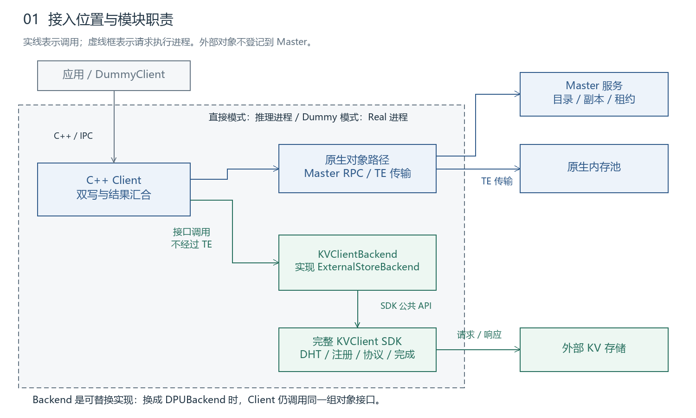
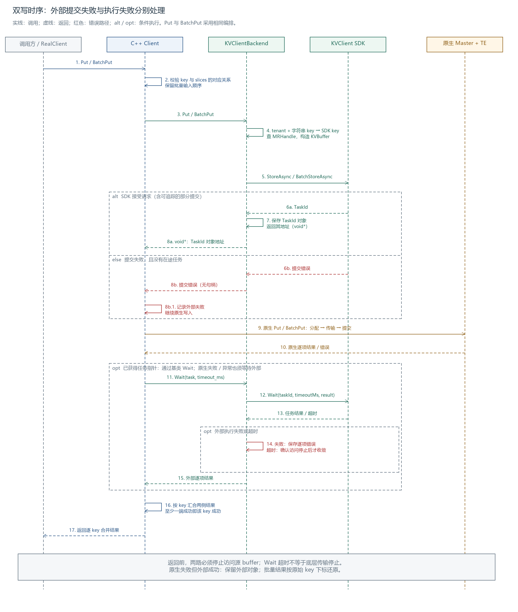
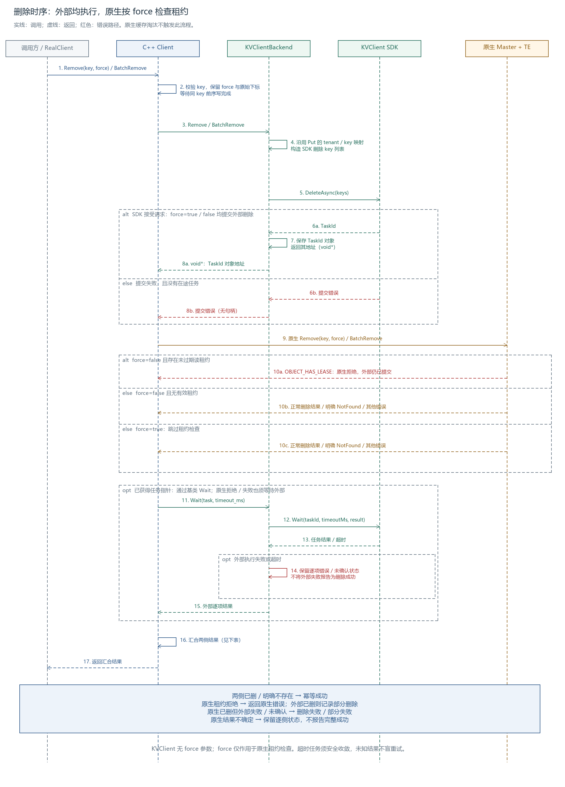

# mooncake接入kvclient put及remove模块设计

**日期：2026-10-22｜状态：模块设计评审**

ExternalStoreBackend 为 Mooncake 提供外部对象存储访问能力，KVClientBackend 封装完整 KVClient SDK。模块负责内存注册、双写编排和显式删除。接口声明见 [external_storage_backend_v3.h](external_storage_backend_v3.h)。

## 1. 背景与需求分析

Mooncake 原生内存副本淘汰后，外部缓存仍可保留 KVCache，降低重新计算开销。Store 通过 KVClientBackend 调用完整 KVClient SDK，原生副本继续使用 Master 与 TE。

| 需求 | 设计约束 |
| --- | --- |
| 双写内存与外部存储 | 外部先提交，原生同步 Put，最后 Wait 外部结果 |
| 按 key 汇合写入结果 | 至少一端成功即返回该 key 成功；返回前两路均停止访问源 |
| 外部独立保留缓存 | 不向 Master 逐项登记外部对象；原生淘汰不删除外部 |
| 显式删除覆盖两端 | 外部先提交，再执行原生删除；逐侧记录结果，部分删除不报完整成功 |
| 后续接入其他 backend | 公共接口不暴露 SDK TaskId、MRHandle 或设备协议 |
| 设备内存直通 | 预注册并复用；不新增 payload gather/staging，不越界访问 |



*图 1：Client 编排两条路径，KVClientBackend 实现 ExternalStoreBackend。[Excalidraw](assets/01-architecture.excalidraw)*

| 模块 | 职责 |
| --- | --- |
| C++ Client | 公共双写/删除流程、同 key 本地排序、结果汇合 |
| RealClient | 公共入口适配、IPC 导入与地址转换 |
| KVClientBackend | key/slices 转换、注册表查找、SDK 任务封装 |
| 完整 KVClient SDK | DHT、节点分组、协议、连接、注册与完成汇总 |

普通 Put 保留原生语义，同 key 内容更新通过 Upsert 完成。本模块定义写入、删除与注册接口；查询和读取接口由读侧模块负责，相关协作约束见第 4、5 节。

## 2. ExternalStoreBackend 接口设计

### 2.1 ExternalStoreBackend 接口定义

```cpp
class ExternalStoreBackend {
public:
    virtual ~ExternalStoreBackend() = default;

    virtual tl::expected<void*, ErrorCode> Put(
        const ObjectKey& key, const std::vector<Slice>& slices) = 0;

    virtual tl::expected<void*, ErrorCode> BatchPut(
        const std::vector<ObjectKey>& keys,
        const std::vector<std::vector<Slice>>& batched_slices) = 0;

    virtual tl::expected<void*, ErrorCode> Remove(
        const ObjectKey& key) = 0;

    virtual tl::expected<void*, ErrorCode> BatchRemove(
        const std::vector<ObjectKey>& keys) = 0;

    virtual std::vector<tl::expected<void, ErrorCode>> Wait(
        void* task, std::uint64_t timeout_ms) = 0;

};
```

对象操作返回 `tl::expected<void*, ErrorCode>`：错误表示提交失败，指针表示具体 backend 的任务数据。Client 根据配置创建具体 backend，写入、删除及等待均通过 ExternalStoreBackend 调用，不依赖 SDK 类型。

**通用 Wait 契约**

| 项目 | 定义 |
| --- | --- |
| task | 提交接口返回的任务指针，仅交给创建它的 backend；Client 不转换或释放 |
| timeout_ms | 等待预算，单位毫秒；超时后安全收敛可能需要额外时间，不代表整个函数的返回上限 |
| 返回结果 | 逐 key 的成功或 ErrorCode，数量和顺序与提交输入一致；单对象返回一项 |
| 生命周期 | backend 持有任务及相关资源，Wait 完成结果处理并安全收敛后回收任务；同一指针仅调用一次 Wait |
| 返回条件 | 任务不再访问调用方 buffer；超时不能仅移除任务记录后返回 |

**KVClientBackend 适配**

```cpp
class KVClientBackend : public ExternalStoreBackend {
public:
    std::vector<tl::expected<void, ErrorCode>> Wait(
        void* task, std::uint64_t timeout_ms) override;
};
```

KVClientBackend 返回其管理的 `kv::TaskId` 对象地址；Wait 内部转换指针，调用 SDK，并将 SDK 调用状态及 TaskResult 逐项状态转换为 Mooncake 结果：

```cpp
auto task_id = *static_cast<kv::TaskId*>(task);
kv::TaskResult result;
auto status = sdk_->Wait(task_id, timeout_ms, result);
```

TaskId 对象由 KVClientBackend 管理，等待及结果处理完成前保持地址有效；不得返回局部变量地址或将整数 TaskId 强转成指针。任务安全收敛后由 backend 回收该对象，调用方不自行释放。SDK 的 `kv::TaskResult` 用于接收结果，再逐 key 转换为 Mooncake 结果。

其他 backend 在 Wait 内对接各自完成机制；同步 backend 可返回保存了已完成结果的任务指针，Wait 立即取回结果。公共流程只调用 `backend_->Wait(task, timeout_ms)`。

### 2.2 KvclientBackend 实现

#### 2.2.1 配置说明与使用范围

配置选择 KVClientBackend 时，须在配置项注释及使用说明中注明以下限制：

> KVClientBackend 适用于直接传入已注册源 buffer 的写入路径，不支持先复制到 Mooncake 内部 buffer 再写入的中转场景，包括 RealClient::put、put_batch、put_parts 及启用 stage_nonlocal 的写入路径。需要此类内存中转时，使用 Mooncake FileStorage。

| 路径 | KVClientBackend 支持范围 |
| --- | --- |
| put_from、batch_put_from、batch_put_from_multi_buffers 等 | 源 buffer 已就绪、已注册，且无需内部中转时支持 |
| put、put_batch、put_parts 等 | 不支持；这些入口先分配 Mooncake 内部 buffer 并复制数据 |
| stage_nonlocal=true | 不支持中转路径；空 stager 的重载委托不受此限制 |

KVClientBackend 的接入目标是直接复用调用方源 buffer。内部中转增加复制和内存管理成本，此类需求使用已有 FileStorage 路径。

#### 2.2.2 key处理

1）Mooncake key格式

AscendStoreConnector 生成字符串 key，原样透传至Mooncake

```python
def to_string(self):
    return (
        f"{self.key_metadata.model_name}"
        f"@pcp{self.key_metadata.pcp_rank}@dcp{self.key_metadata.dcp_rank}"
        f"@head_or_tp_rank:{self.key_metadata.head_or_tp_rank}"
        f"@pp_rank:{self.key_metadata.pp_rank}@{self.chunk_hash}"
    )
```

各字段含义：

- `model_name`：不同模型天然隔离
- `pcp/dcp rank`：pipeline-context / data-context parallel rank
- `head_or_tp_rank`：同一条 prompt 在不同 TP rank 上的 KV 分片用这个区分
- `chunk_hash`：块内容哈希，**前缀缓存复用的本体**
- 层号（layerwise 模式）：`LayerPoolKey.to_string()`在此基础上追加 `@{layer_id}` 后缀

2）Mooncake key对tenant的处理

tenant直接用于master service的索引
```
Python: store.setup(..., tenant_id="team-a")
  ↓
RealClient::setup_internal(..., tenant_id)
  └─ 未显式传入时：tenant_id = get_config(config, "tenant_id", "default")
  ↓
MasterService::PutStart(client_id, key, tenant_id, ...)
  ↓
元数据存储: shard->tenants[tenant_id].metadata[key]
```

一些场景把 tenant 拼接入 key，例如soft-pin 索引：
```

std::unordered_map<std::string, Registration> registrations_;  // key 就是 scoped_key

const auto scoped_key = metadata.tenant_id.MakeScopedKey(metadata.user_key);

std::string MakeScopedKey(std::string_view local_key) const {
        std::string scoped_key;
        scoped_key.reserve(value_.size() + local_key.size() + 1);
        scoped_key.append(value_);
        scoped_key.push_back(kScopedKeySeparator);
        scoped_key.append(local_key);
        return scoped_key;
    }
```
3）KvClientBackend key的构建
```
KVBuffer {
    key;
    buffer {
        region { memoryType, addr, size, deviceId, numaNode };
        handle;
    };
    offset;
    mrKey;
}
```

| KVBuffer 字段 | Mooncake 字段处理 |
| --- | --- |
| key | MakeScopedKey 哈希 |
| buffer.region.addr | Slice.ptr |
| buffer.region.size | Slice.size |
| offset | 固定填充 0。同一 key 下前面所有 slice 长度之和，需要 512 位对齐，由于 mooncake 的 key 已经携带了 layer、tp 等信息，所以可直接填充 0。 |
| deviceId | PointerInfo.device_id |
| numaNode | 无需填充 |
| memoryType | 根据实际源内存类型填写 HOST 或 DEVICE；不通过入口名称推断，不支持 RealClient::put 等内部中转路径 |
| buffer.handle / mrKey | handle 由注册时拿到，mrKey 由 KvClient 填充 |

## 3. 关键流程

### 3.1 双写

一、接口支持情况


<table>
<thead>
<tr>
<th rowspan="2">接口</th>
<th colspan="2">接口支持</th>
<th colspan="3">原接口功能</th>
</tr>
<tr>
<th>KVClientBackend 是否支持</th>
<th>处理方式</th>
<th>入参</th>
<th>行为</th>
<th>使用场景 / 调用者</th>
</tr>
</thead>
<tbody>
<tr><td><code>Client::Put(key, slices, config)</code></td><td>是</td><td>外部 Put 提交 → 原生 Put → Wait；仅支持无需内部中转的源 buffer</td><td>key + <code>std::vector&lt;Slice&gt;</code></td><td>PutStart 分配副本，传输，PutEnd 提交</td><td><code>RealClient::put_from</code>；put、put_parts 虽调用此接口，但不在 KVClientBackend 支持范围内</td></tr>
<tr><td><code>Client::BatchPut(keys, batched_slices, config)</code></td><td>是</td><td>以空 stager 委托共同实现；仅支持无需内部中转的源 buffer</td><td>多 key + 每个 key 的 slices</td><td>批量分配、传输、提交</td><td><code>RealClient::batch_put_from</code>、<code>batch_put_from_multi_buffers</code>；不支持 put_batch 中转入口</td></tr>
<tr><td><code>Client::BatchPut(keys, batched_slices, config, WriteBufferStager)</code></td><td>否</td><td>不支持启用 stager 的中转场景；空 stager 委托按普通 BatchPut 处理</td><td>同上 + stager</td><td>非本地 buffer 可先 staged 到内部 buffer</td><td>RealClient 的 <code>stage_nonlocal=true</code> 路径</td></tr>
<tr><td><code>Client::Upsert / BatchUpsert</code></td><td>是</td><td>外部 Put / BatchPut 提交 → 原生 Upsert / BatchUpsert → Wait；KVClient Store 支持同 key 覆盖写，不因 key 已存在报错</td><td>key(s) + slices</td><td>存在则更新，不存在则插入</td><td>upsert 系列</td></tr>
<tr><td><code>Client::TransferWriteRange(replica, slices, dst_offset)</code></td><td>否</td><td>范围传输，在Client层无key，上层RealClient有key但语义不合适</td><td>已缓存的副本描述 + slices + 目标偏移</td><td>往已有 memory replica 的指定区间写</td><td>Put session 的分段写</td></tr>
<tr><td><code>Client::BatchTransferWriteRanges(...)</code></td><td>否</td><td>范围传输，在Client层无key，上层RealClient有key但语义不合适</td><td>多副本 + 多 slices + 多偏移</td><td>批量区间写</td><td>Put session 批量分段写</td></tr>
<tr><td><code>Client::StartBatchPutForSizes(keys, sizes, config)</code></td><td>否</td><td>只有对象大小，没有源 buffer</td><td>keys + 对象大小</td><td>只做批量写的分配阶段，预留副本空间</td><td>Put session start</td></tr>
<tr><td><code>Client::BatchPutEnd(object_metas, replica_type)</code></td><td>否</td><td>只有元数据，没有源 buffer</td><td>对象元数据 + 副本类型</td><td>提交 Put session</td><td>Put session end</td></tr>
</tbody>
</table>

Mooncake 将分阶段写入能力通过 `StartBatchPutForSizes` 等接口暴露给上层，由推理引擎编排各阶段调用，Mooncake 内部未调用这几个接口完成整个写入流程。

多 slices 的整对象 Put 一次提交完整对象；Put session 则跨多次调用写入区间。范围写接口不携带对象 key 和完整提交状态，不能直接映射为外部 Store。

二、双写实现

**执行时序**



*图 3：Client 内部编排 backend 与原生路径；提交失败继续原生写，有句柄时等待外部完成，按 key 合并两侧结果。[Excalidraw](assets/v4/03-dual-put-sequence-split.excalidraw)*

**第5步骤 storeAsync的 eventHandle处理**

AscendStore 普通路径在进入 Mooncake 前等待 NPU event，因此 KVClient StoreAsync 无需再传入 eventHandle：

1. **记录事件**：计算流通过 `torch.npu.Event().record()` 标记源数据就绪点。
2. **等待事件**：后台发送线程执行 `current_event.synchronize()`。
3. **提交写入**：`self.m_store.put(...) → MooncakeBackend.put → batch_put_from_multi_buffers`。


**第12步 Wait 超时终止 ASU 底层任务**

ASU 可配置 `maxErrorCount=1`，使首次计入断链的传输错误或任务执行超时即可触发断链，避免等待多次失败。Wait 超时后，KVClientBackend 通过断链保证底层不再访问源 buffer。


三、结果处理与数据可见性

**原生副本模式与成功要求**

Mooncake 按 key 判断原生写入结果；副本模式仅约束原生路径，不包含 KVClient 外存。

| ReplicaWriteMode | 典型配置 | 原生成功要求 | 失败侧处理 |
| --- | --- | --- | --- |
| SINGLE_REPLICA | 1 份 memory，其他副本数为 0 | 分配满足要求，已分配副本传输成功 | 失败时 PutRevoke(ALL) |
| RELIABLE_MULTI_REPLICA | N 份 memory（N > 1）；NoF 多副本或配置 DFS 也属于此模式 | 分配满足要求，所有已分配副本传输成功 | 任一失败则 PutRevoke(ALL)，原生返回失败 |
| FLEXIBLE_DUAL_REPLICA | 1 份 memory + 1 份 NoF，DFS 为 0 | 至少一类副本完整写入成功 | PutEnd 成功侧，PutRevoke 失败侧；两侧失败则撤销全部 |

成功还要求相应 PutEnd / PutRevoke 调用成功。原生 PutRevoke 只作用于 Master 管理的副本，不删除 KVClient 对象。

**双写结果汇合策略**

1. **原生结果**：沿用上述模式判断，完成原生提交或撤销。
2. **外部结果**：KVClientBackend 通过 Wait 获取逐 key 结果。
3. **最终结果**：同一 key 至少一端成功即返回成功；两端均未确认成功则返回失败，记录两侧状态。原生失败、外部成功时保留外部对象，不自动回滚删除。

**ASU 数据可见性（按 Store 状态）**

| 外部对象状态 | Load 结果 | 处理规则 |
| --- | --- | --- |
| 未 Store，存储端不存在该对象 | 不存在错误 | 视为外部 miss；结合原生结果判断是否返回 NotFound |
| Store 已提交，尚未完成 | 未写先读错误 | 视为未就绪，不当作不存在；可换源，或在读取预算内等待后重试 |
| Store 已完整成功 | 可正常读取 | 以 Load 实际完成结果判断读取是否成功 |

因此，未完成的 Store 不会被 Load 当作完整对象成功读取；仅在 Store 完整成功且 Load 成功完成后，调用方才能消费目标 KVBuffer，保证读取到完整数据。

### 3.2 删除

一、接口支持情况

<table>
<thead>
<tr>
<th rowspan="2">接口</th>
<th colspan="2">接口支持</th>
<th colspan="3">原接口功能</th>
</tr>
<tr>
<th>KVClientBackend 是否支持</th>
<th>处理方式</th>
<th>入参</th>
<th>行为</th>
<th>使用场景 / 调用者</th>
</tr>
</thead>
<tbody>
<tr><td><code>Client::Remove(key, force)</code></td><td>是</td><td>外部 Remove 提交 → 原生 Remove → Wait；汇合两侧结果</td><td>key + force</td><td>删除对象及其原生副本；force 控制原生租约检查</td><td><code>RealClient::remove</code></td></tr>
<tr><td><code>Client::BatchRemove(keys, force)</code></td><td>是</td><td>外部 BatchRemove 提交 → 原生批量删除 → Wait；结果按原始下标还原</td><td>keys + force</td><td>批量删除对象，逐项返回结果</td><td><code>RealClient::batchRemove</code></td></tr>
<tr><td><code>Client::RemoveByRegex(str, force)</code></td><td>否</td><td>kvclient未提供正则删除的能力</td><td>正则表达式 + force</td><td>删除匹配表达式的原生对象</td><td><code>RealClient::removeByRegex</code>；按条件清理</td></tr>
<tr><td><code>Client::RemoveAll(force)</code></td><td>否</td><td>kvclient全量清理能力未提供</td><td>force</td><td>删除原生对象及其副本</td><td><code>RealClient::removeAll</code>；全量清理</td></tr>
<tr><td><code>Client::EvictDiskReplica(...)</code>（两个重载）</td><td>否</td><td>仅通知 Master 淘汰原生磁盘副本，保留外部对象</td><td>key + replica_type；可显式指定 tenant_id</td><td>移除对应磁盘副本记录</td><td>本地磁盘副本淘汰 / 失效处理</td></tr>
<tr><td><code>Client::EvictDiskReplicaIfCurrent(...)</code></td><td>否</td><td>仅在副本身份仍匹配时淘汰原生副本</td><td>key + tenant_id + replica_type + expected_replica_id</td><td>条件淘汰，防止误清理已替换的副本</td><td>读取失败后的副本核验与清理</td></tr>
<tr><td><code>Client::BatchEvictDiskReplica(...)</code>（两个重载）</td><td>否</td><td>批量淘汰原生磁盘副本，保留外部对象</td><td>keys + replica_type；可显式指定 tenant_id</td><td>批量移除对应磁盘副本记录</td><td>批量磁盘淘汰 / 失效处理</td></tr>
<tr><td><code>Client::PollRemoveAll()</code></td><td>否</td><td>仅查询原生清理状态，不发起删除</td><td>无</td><td>向 Master 轮询清理状态</td><td>原生清理状态轮询</td></tr>
</tbody>
</table>

二、删除实现

**执行时序**



*图 4：force 两种取值均提交外部删除；原生侧按租约分支处理，最后 Wait 并汇合逐侧结果。[Excalidraw](assets/v4/04-delete-sequence-split.excalidraw)*

```text
提交外部 Remove → 执行原生 Remove(key, force) → Wait 外部结果 → 汇总两侧结果
```

同 key 前序写先收敛，再提交外部删除；原生删除完成后，等待已提交的外部任务并汇合结果。原生缓存淘汰不透传 Remove。

**force 与读租约**

Query 获取副本信息时，Master 通过 `GrantLease` 授予短期读租约（`lease_timeout`）。`force` 仅控制原生路径的租约检查。因为外部存储没有接入Mooncake Master 的这套租约，想要拿到该key是否在租约内要等待原生删除行为完成，才能根据原生删除结果决定是否删除外部存储，与当前架构不符。

| force | 原生删除行为 | 外部删除行为 |
| --- | --- | --- |
| false（默认） | 租约未过期则拒绝，返回 `OBJECT_HAS_LEASE` | 提交删除并 Wait |
| true | 跳过租约检查，可能影响在途读取 | 提交删除并 Wait |

三、结果处理

两侧都确认“已删或不存在”才成功；一侧失败或未确认，就返回错误并记录两侧状态。


## 4. Client 不支持/仅原生接口清单

| 入口 | 本期处理 | 原因 / 条件 |
| --- | --- | --- |
| put / put_batch / put_parts 及启用 stage_nonlocal 的写入变体 | KVClientBackend 不支持；配置说明明确标注 | 先复制到 Mooncake 内部 buffer 的中转场景使用 FileStorage，见 2.2.1 |
| get_buffer / batch_get_buffer | 仅原生，不加外部 fallback | 不新增由 Store 分配 payload 的路径；原生 miss 不代表外部不存在 |
| getSize / get_size | 长度来源未落实前不接外部 | lookup 命中位不能替代长度；不得返回伪造的 0 |
| get_into_ranges、batch_get_into_multi_buffer_ranges | 待读侧扩展，当前外部返回不支持 | 需精确范围、目标偏移、对齐和边界验证 |
| 原生 QueryResult snapshot、get session | 仅原生 | 不伪造外部副本/租约，不暗中重查快照 |
| put session、分段写、BatchTransferWriteRanges | 外部模式预先拒绝 | 与整对象 Put 语义不同，不能静默只写一侧 |
| Upsert 及批量/多 buffer 变体 | 接入外部双写 | 外部使用 Store 覆盖写，原生保留 Upsert 语义；多 buffer 按对象完整性要求处理 |
| RemoveAll / RemoveByRegex | 外部模式预先拒绝 | 必须覆盖外部对象；只遍历 Master 会漏删外部独存对象 |
| replica descriptor、copy/move、replica clear、segment 操作 | 保持原生语义 | 外部不受 Master 物理副本控制 |

基础 Put/Upsert/Remove 及批量方法走第 2、3 节流程。多 buffer、metadata 写入需保序并验证 backend 能力；不支持布局的普通 Put 外部项可失败而保留原生结果。查询、读取及其扩展入口由读侧模块落实。尚未接入外部的会话写、全量删除等调用，必须在副作用前拒绝或使用明确命名的 native-only 管理入口。

## 5. 异常分析

E01—E10 标识各类异常及其验证用例。标为**阻塞项**的能力或安全保证，须在对应功能启用前完成实现与验证。

| 编号 / 项目 | 处理规则 | 缺口 / 验证点 |
| --- | --- | --- |
| E01 API 覆盖 | 按第 4 节逐入口区分；Unsupported 不冒充成功；条件删除不只枚举 Master | 核对包装入口是否绕过公共流程；T01 |
| E02 key 与命名空间 | 完整字符串交给 backend；保留已有 tenant 上下文；禁止截断/hash64 冒充无碰撞映射 | SDK 仅 8 字节，完整身份映射为阻塞项；T02 |
| E03 长度与布局 | 对象长度由 slices 检查求和；多段保序；全对象完整后才可见；不复制/越界补齐 payload | 持久长度来源、原子发布、多段与协议上限为阻塞项；T03 |
| E04 路由与顺序 | 选择按 key 稳定路由，筛选/重排不改变位置；本客户端队列覆盖两路完成；未知前序不放行后项 | 验证迁移及 SDK 顺序；跨 Client 不承诺线性有序，需仲裁或明确单写者约束；T04 |
| E05 设备内存 | Real 导入后注册；按设备/context 区分；逐组合启用 | GPU/NPU × UB/RoCE × 直接/IPC，覆盖多卡及注销；未验证组合禁用；T05 |
| E06 查询与读取异常 | 默认原生优先；明确 miss 才查外部，原生 error 单独返回；并行模式已有 Hit 可用；两端明确 miss 才 NotFound | Error/NotReady/Pending 分开；安全停止前不切换目标写来源；T06 |
| E07 读取策略 | 建议默认 native-first；自定义策略配并行查询；缺位置/网络字段标 Unknown，策略异常回退默认 | content_tag/长度冲突报错；目标重叠预检查拒绝；策略元数据封装待对齐；T07 |
| E08 删除部分失败 | 按 3.2 执行外部先提交的双删；force 仅影响原生租约检查；逐项记录两侧结果 | 原生拒绝而外部已删时返回原生错误；部分失败/重建时的幂等及代际保护为阻塞项；T08 |
| E09 SDK 初始化失败 | 建议默认启动失败；仅显式配置允许 native-only，向调用方/运维暴露原因与 effective_mode | 运行中外部失联不静默变 miss；区域注册失败不能标为外部就绪；T09 |
| E10 超时与退出 | 结果超时与访问停止分开；ASU 达到 maxErrorCount 后触发断链；退出先收敛任务再注销、关映射 | 单次超时未必达到断链阈值；断链完成与停止访问的保证须验证，见 5.2；T10 |

### 5.1 查询、重试与预算

| 场景 | 执行规则 |
| --- | --- |
| 串行原生优先 | 原生命中即读；明确 miss 才查外部；原生错误不作为 miss 继续 |
| 可选并行查询 | 已返回 Hit 可服务；默认不额外等待偏好来源；仍在执行的查询由后端持有收敛 |
| 一端 miss，另一端错误/未就绪/未返回 | 分别返回明确错误/NotReady/Timeout，不返回 NotFound |
| 读取失败 | 建议最多一次换源；前源先停止访问，回退完整覆盖本次目标；无成功回退时目标不可消费 |
| 参数、权限、内容冲突 | 不重试；冲突不通过静默换源掩盖 |
| 可恢复路由/连接错误 | 建议最多一次重试，共享总 deadline；结果未知的写删不盲重发 |

超时预算分为 `query_timeout_ms`、`io_timeout_ms`、`quiesce_timeout_ms`、`shutdown_timeout_ms`。具体值由设备压测确定并在启用时校验；重试共享原始 deadline。读取策略需要候选的内容身份、来源、逻辑长度和位置提示，元数据载体及接口由读侧模块定义。

### 5.2 内存安全底线

**Wait 超时，不代表远端已停止访问。** 后台持有 MR/映射引用只能维持注册资源，不能保证调用方修改或复用 payload 的安全性。同步 API 返回前，必须取得访问完成或远端访问权限已撤销的依据。当前接口尚未定义有界取消与停止访问机制，该保证为启用前阻塞项。

**ASU 断链计数范围。** ASU 对连接上的传输类错误累计计数，达到配置项 `maxErrorCount` 后触发断链。该机制用于故障连接收敛，不作为其他 backend 的通用要求。

| 失败情况 | 是否增加断链计数 |
| --- | --- |
| CQE 内部错误 `CQE_INTERNAL_ERROR` | 是 |
| CQE IO 超时 `CQE_IO_TIMEOUT` | 是 |
| SDK 传输任务执行超时 `TIMEOUT` | 是 |
| 底层 `Send` 返回失败 | 是 |
| key 不存在 | 否 |
| 资源忙 `CQE_RESOURCE_BUSY` | 否 |
| 超出创建容量 `CQE_OUT_OF_CREATE_SIZE` | 否 |
| 介质写错误 `CQE_WRITE_FAULT` | 否，当前未纳入 |
| 不可恢复读错误 `CQE_UNRECOVERED_READ_ERROR` | 否，当前未纳入 |

Wait 超时后，须等待任务停止访问，或确认断链清理已撤销在途访问，再释放任务及注册资源、允许调用方复用 buffer。**未达到断链阈值、仅发起断链或仅删除任务记录，均不能作为访问停止依据。** 断链完成是否保证设备不再访问内存，须通过对应设备与协议组合验证。

正常退出顺序：**停止新请求 → 区域禁用新引用 → 在统一 deadline 内收敛两路访问 → 注销 SDK/TE → 关闭 IPC → 销毁 SDK**。无法证明访问已停止的组合不得宣称满足安全有界返回；进程崩溃/断链同样需要设备级故障注入验证。

## 6. SFMEA 分析与测试规划

### 6.1 失效模式与影响

P0 表示错误数据、越界或提前释放风险；P1 表示一致性/可用性风险。发生率与可探测性尚无测量数据，暂不计算 RPN；优先级在联调后复核。

| 失效模式 | 影响 | 优先级 | 预防 / 检测 | 测试 |
| --- | --- | --- | --- | --- |
| 不支持入口被静默执行 | 用户误以为双写/全量删除完成 | P1 | 调用前覆盖校验，断言不产生外部副作用 | T01 |
| key 碰撞 / tenant 串扰 | 读错、覆盖或误删其他对象 | P0 | 完整身份校验，受限映射拒绝不适用 key | T02 |
| 多段乱序、半写可见、长度越界 | 对象损坏或访问越界 | P0 | 总长/范围校验、完整发布点、边界 guard | T03 |
| 迟到写越过删除 / 路由漂移 | 对象复活或外部假 miss | P1 | 稳定路由、同 key 队列、未知前序隔离 | T04 |
| MR/context 错配或 IPC 过早关闭 | 错数据、设备错误、非法访问 | P0 | 分配代际与 context 校验、在途引用、撤销顺序 | T05 |
| 查询错误伪装 miss、读失败继续消费 | 重算掩盖故障或消费不完整数据 | P0 | 明确状态映射、失败目标禁用、安全换源 | T06 |
| 策略错误 / 目标重叠 | 选错来源或竞争覆盖 | P0 | 候选合法性与重叠预检、策略回退 | T07 |
| 删除部分失败却报成功 / 旧重试误删新对象 | 残留缓存或错误删除 | P1 | 分阶段记录、结果汇合、代际/幂等保护 | T08 |
| SDK 初始化失败却标外部可用 | 运行行为与配置不一致 | P1 | 启动策略、区域状态、告警与 effective_mode | T09 |
| 超时后复用 buffer / 退出先注销 | 迟到 DMA、内存破坏 | P0 | 真实访问停止依据、任务保留、统一退出期限 | T10 |

### 6.2 测试用例与验收点

| ID | 测试内容 | 通过标准 |
| --- | --- | --- |
| T01 | 遍历单/批、多 buffer、范围、会话、Upsert、All/Regex；关闭外部回归 | 每个入口与第 4 节一致；被拒绝调用不产生副作用 |
| T02 | 长 key、内嵌零、强制碰撞、同名跨 tenant、重启 | 不错误合并/返回/删除对象；不支持情况明确拒绝 |
| T03 | 多段/metadata 顺序、半写查询、空对象、协议上下限、非对齐 | 只有完整对象可读；源/目标 guard 不变；无隐式 payload 复制 |
| T04 | 筛选/重排批次、路由变更、同客户端延迟 Put→Remove、跨客户端写删 | 同 key 可定位；已声明顺序得到满足；未支持并发明确拒绝/限制 |
| T05 | 设备×协议×IPC 矩阵，多卡同地址、地址复用、注册回滚、在途撤销 | 正确 MR/context；注册次数不随 Put 次数增长；映射不提前关闭 |
| T06 | Hit+Error、Miss+Error、Pending/NotReady；部分读失败再换源 | 错误不变 miss；前源先停；返回成功时目标完整有效 |
| T07 | 缺失位置/tag、策略异常、非法候选、重叠目标 | 按约定回退/报错；重叠批次零派发；内容冲突不被掩盖 |
| T08 | force 两种取值、原生租约拒绝、Master NotFound、外部删除失败、删除后重建再重试 | 两种 force 均先提交外部删除；原生拒绝时返回原生错误并记录部分删除；缺失仍删外部；不误删新对象 |
| T09 | SDK/目录/注册初始化故障；运行中外部失联 | 启动/降级显式可见；无外部假就绪或假 miss |
| T10 | Wait 超时、迟到完成；ASU 未达/达到 maxErrorCount、各错误计数分支；断链清理；Dummy/Real 退出与崩溃 | 计数与 5.2 一致；未达阈值不提前释放；达到阈值触发断链，确认无在途访问后才回收；退出预算与安全释放均有证据 |

### 6.3 分阶段执行

| 阶段 | 环境 | 重点 |
| --- | --- | --- |
| 单元测试 | fake 同步/异步 backend | 参数、句柄、批量下标、双写四组合、部分提交与异常清理 |
| 集成测试 | Mooncake + SDK，可控故障注入 | 注册复用、IPC、路由、错误映射、删除分支 |
| 硬件验收 | 精确设备/provider/协议版本矩阵 | payload 完整性、边界保护、延迟、超时及退出时的访问停止 |

发布门槛：P0 控制项均有测试证据；E02/E03/E04/E08/E10 中影响所启用功能的阻塞项关闭；未验证入口/组合不得启用。

**测试执行状态：上述单元、集成和硬件验收用例尚未执行。**

### 6.4 源码依据

| 核对点 | 本地入口 |
| --- | --- |
| Mooncake 类型与 API | [types.h](/D:/workspace/Mooncake/mooncake-store/include/types.h)、[client_service.h](/D:/workspace/Mooncake/mooncake-store/include/client_service.h) |
| SDK 预注册 / mrKey | [kv_client_impl.cc:330](/D:/workspace/unified-cache-management/kv_semantics/src/client/kv_client_impl.cc:330)、[提交转换:454](/D:/workspace/unified-cache-management/kv_semantics/src/client/kv_client_impl.cc:454) |
| Wait 超时行为 | [task_manager.cc:108](/D:/workspace/unified-cache-management/kv_semantics/src/client/task/task_manager.cc:108)、[对应单测](/D:/workspace/unified-cache-management/kv_semantics/tests/client/kv_client_impl_test.cc:1959) |
| key / 协议约束 | [kv_types.h](/D:/workspace/unified-cache-management/kv_semantics/include/kv_types.h)、[kv_protocol.cc](/D:/workspace/unified-cache-management/kv_semantics/src/trans/proto/kv_protocol.cc:185) |
| IPC 导入 / 生产 event | [RealClient](/D:/workspace/Mooncake/mooncake-store/src/real_client.cpp:3260)、[AscendStore](/D:/workspace/vllm-ascend/vllm_ascend/distributed/kv_transfer/kv_pool/ascend_store/kv_transfer.py:237) |
