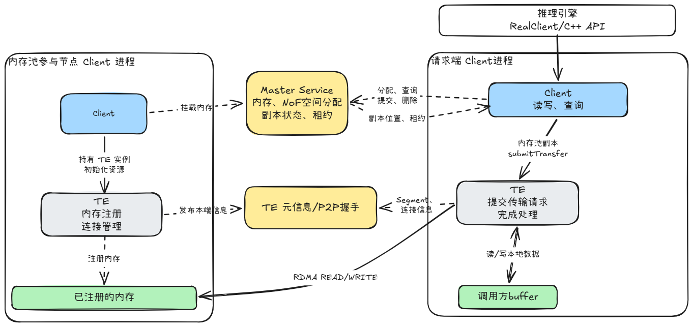
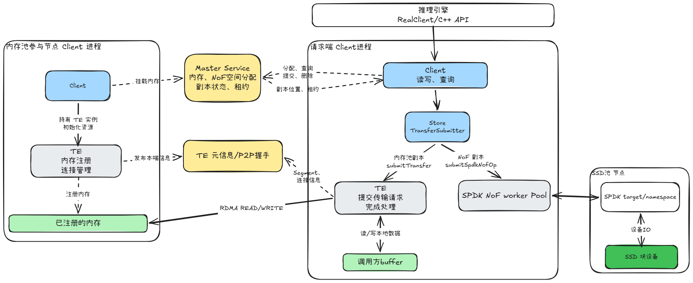
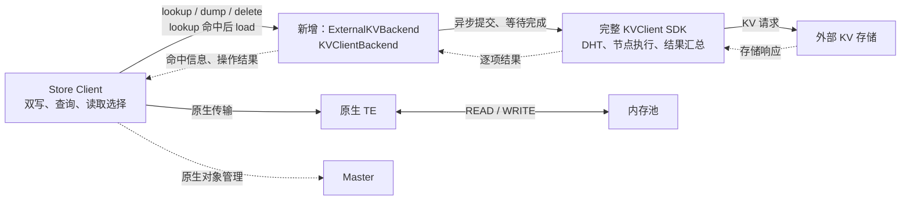
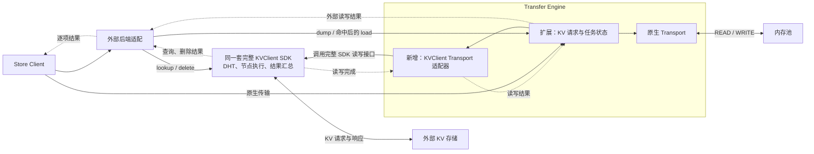
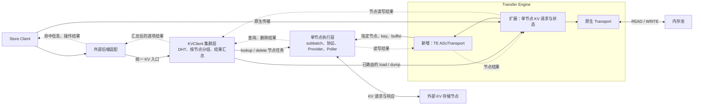
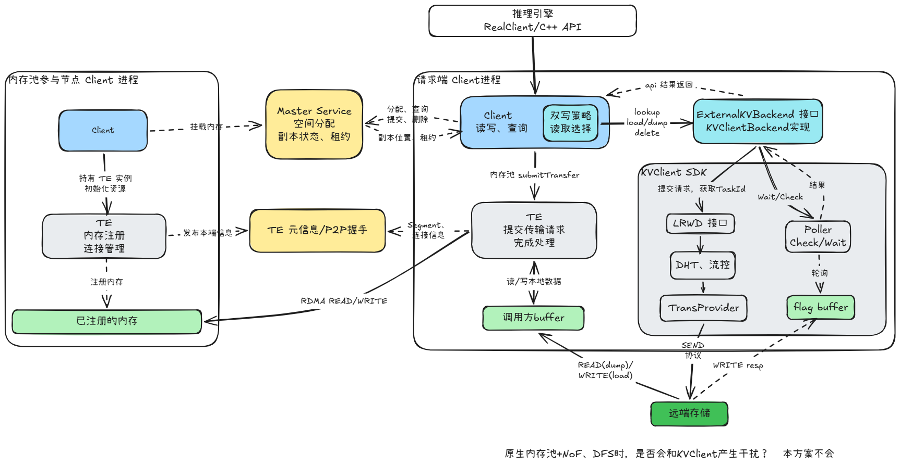

# Mooncake + KVClient 双写

## 1 Motivation

目标：通过 KVClient 为 Mooncake 接入外部 KV 存储，与原生内存池双写。内存副本淘汰后，外部存储仍可提供缓存，扩大 KVCache 的保留范围。
读取优先使用原生副本。原生未命中时，先通过 KVClient lookup 查询，确认外部命中后再 load 到调用方的 buffer。两端均未命中才返回缓存未命中，查询错误增加错误处理。

### 1.1 引入KVClient的优势:

**1、按 key 访问，由存储端搬运数据**
KVClient 通过 DHT 选择节点，存储端根据 key 定位对象，再主动读写调用方的设备内存，完成后写回结果。Mooncake 只需提交 key 和 buffer，无需维护外部对象的物理位置。
存储端掌握请求的对象和操作，可以在此基础上增加请求聚合、调度、近存计算，或通过 DPU 卸载协议处理和数据搬运。这些是后续可扩展的方向。

**2、扩展外部容量，无需扩展 Master 的对象目录**
外部对象由 KVClient 查询，不逐项登记到 Master。内存副本淘汰、Master 中的对象记录回收后，仍能找到外部缓存。因此，外部存储保留更多 KVCache 时，无需在 Master 中为它们增加副本记录；原生副本仍按现有方式管理。
Master 状态管理的相关讨论包括 [#4700（全局状态锁）](https://github.com/kvcache-ai/Mooncake/issues/4700)、[#4557（tenant-first 迁移）](https://github.com/kvcache-ai/Mooncake/issues/4557)和 [#2979（Entity Ownership）](https://github.com/kvcache-ai/Mooncake/issues/2979)。这些提案优化已有状态的管理，本方案则将外部对象目录交给存储系统。

**3、NPU/GPU 直通外部存储**
KVClient 支持通过 UB/RoCE 直接访问设备 buffer，KVCache 数据不经过本机 Host 暂存。相比当前 DFS 对设备数据先 D2H、再写存储的路径，可以省掉这段中转。

### 1.2 范围与约定

双写模式同时使用原生内存池和外部存储，原生路径仍需要 Master

- 同一个 key 的内容不可变。
- 读取只支持调用方准备好 buffer 的 `get_into` 类接口，暂不支持外部 `get_buffer`。
- 双写时，外部写入失败不改变原生 Put 的结果。同步返回前，两端都应结束对输入 buffer 的访问，因此仍需等待外部操作完成。
- 数据内存由调用方管理，不复制 payload 来延长任务生命周期。操作完成前，buffer 和注册资源必须保持有效。
- 原生淘汰不删除外部对象。显式 Remove 透传到 KVClient，即使 Master 中已经没有该 key。
- 本客户端对同一 key 的写入和删除按顺序提交，由 SDK 保证所需执行顺序。
- 接入覆盖 Store C++ Client 和 RealClient 的相关入口。原生路径继续使用 Master 和 TE，外部路径使用完整 KVClient。

字符串 key、变长对象、Dummy/Real 下的设备内存注册，以及写入和删除部分失败、SDK 超时后的处理，在模块设计中展开。

纯 Storage 模式（不拉起Master，只通过 KVClient 访问外部存储）待讨论。

## 2 现状

> 以下内容总结自 Mooncake 2026-10-19 的代码和RFC，commit 为 [`5d0636f5`](https://github.com/kvcache-ai/Mooncake/tree/5d0636f5d39f9de729a58ea036f98c395dd0b291) 

### 2.1 Mooncake 原生架构

Mooncake Store 由 Master 和 Client 组成，Client 可以发起对象请求，也可以贡献内存，作为内存池节点。

- **请求端 Client**：提供 Put、Get、Remove 等对象接口，查询并选择副本，提交数据传输。
- **Master**：维护对象目录、内存池空间、副本状态和租约，处理分配、提交、查询、淘汰等请求，不转发对象数据。
- **内存池节点的 Client**：挂载内存池、发送心跳，通过 TE 注册内存，供请求端访问。
- **Transfer Engine（TE）**：管理内存注册、连接和数据传输。Store 将对象操作转换为具体地址上的 READ/WRITE，TE 不负责按 key 查找对象。

TE 还需要传输元数据，例如已注册的内存区域、访问凭据和连接信息。这与 Master 的对象目录是两类信息：Master 回答对象有哪些副本、在哪里；TE 元数据用于建立连接并访问这些地址。[Store 架构](https://github.com/kvcache-ai/Mooncake/blob/5d0636f5d39f9de729a58ea036f98c395dd0b291/docs/source/design/store/mooncake-store.md)、[TE 设计](https://github.com/kvcache-ai/Mooncake/blob/5d0636f5d39f9de729a58ea036f98c395dd0b291/docs/source/design/transfer-engine/index.md)

写入内存池时，Client 通过 `PutStart` 向 Master 申请副本空间，传输完成后通过 `PutEnd` 提交。读取时，Client 取得已完成副本的位置和读取租约，选择副本，再通过 TE 读取数据。以 RDMA 为例，写入和读取分别由请求端发起 RDMA WRITE、RDMA READ，数据不经过 Master。

Client 可以与应用运行在同一进程，也可以采用 Dummy/Real 模式：应用中的 Dummy 将请求交给本机 RealClient，后者持有 Store Client 和传输资源。独立的 Store 服务也由 Client 提供内存池能力。这些部署方式不改变上述对象管理和传输分工。

### 2.2 存储接入方式梳理

目前有本地文件、NVMe KV、OSS、NoF 和 DFS 五条路径。
前三条由 `FileStorage` 调度，写入后登记为 `LOCAL_DISK`；NoF 和 DFS 则在 Put 时向 Master 申请对应副本。

**1、FileStorage offload：本地文件、NVMe KV、OSS**

`FileStorage` 运行在持有内存副本的 Client 中，后台通过 `OffloadObjectHeartbeat` 取得 Master 下发的任务，从本节点内存副本取数据，再调用后端的 `BatchOffload`。成功后通知 Master，登记 `LOCAL_DISK` 副本，记录所属 Client、RPC 地址和对象长度。应用写内存与后台 offload 是两个过程。

三个后端共用这套流程，区别在存储访问方式和对象布局：

- **本地文件**：通过 Bucket、FilePerKey、OffsetAllocator 等后端读写文件，分别采用对象聚合、每个 key 一个文件、文件内分配偏移等布局。
- **NVMe KV**：`NvmeKvStorageBackend` 负责物理 key 编码、对象校验和大对象分块，Connector 连接设备，Executor 通过 io_uring 或 ioctl 提交 NVMe KV 命令。当前实现面向单个本地设备。
- **OSS**：`DistributedStorageBackend` 通过 OSS adapter 发出 HTTP PUT/GET；对象 key 带有 owner 前缀。底层虽然是远端对象存储，Store 中仍登记为某个 Client 所属的 `LOCAL_DISK`。

跨进程读取时，请求端先向 Master 查到 `LOCAL_DISK` 副本，再向其所属 Client 发出 `batch_get_offload_object`。该 Client 从对应后端读入已注册的 `ClientBuffer`，返回 buffer 描述；请求端通过 TE 拉取，完成后释放暂存 buffer。同进程 GPU 读取另有 pinned buffer 加 H2D 的路径。

这三条路径读取时都依赖副本所属 Client，但`LOCAL_DISK` 并不表示底层只能是本地磁盘。[SSD offload 设计](https://github.com/kvcache-ai/Mooncake/blob/5d0636f5d39f9de729a58ea036f98c395dd0b291/docs/source/design/store/ssd-offload.md)、[NVMe KV 设计](https://github.com/kvcache-ai/Mooncake/blob/5d0636f5d39f9de729a58ea036f98c395dd0b291/docs/source/design/store/nvme-kv-backend.md)、[OSS 设计](https://github.com/kvcache-ai/Mooncake/blob/5d0636f5d39f9de729a58ea036f98c395dd0b291/docs/source/design/store/oss-backend.md)

**2、NoF：远端 NVMe-oF SSD 池**

NoF 按块地址访问 SSD。Master 分配空间，记录 `NOF_SSD` 副本的 namespace endpoint、偏移和长度，并负责空间回收。请求端从 Master 取得描述符后，直接访问远端 namespace。

- **写入**：请求端 Client 用输入 buffer 写内存副本和 NoF 副本。内存路径使用 TE；NoF 路径由 Store 的 `TransferSubmitter` 转交 SPDK NoF worker，按 LBA 写 SSD。
- **顺序**：NoF 不以内存写入成功为前提。当前同步 Put 逐个执行副本传输，一侧失败后仍会尝试另一侧。
- **返回结果**：配置为一个内存副本、一个 NoF 副本、无 DFS 时，任一侧成功即可提交，并撤销失败侧。包含 NoF 的其他多副本配置，以及包含 DFS 的配置，要求按配置完成分配且全部写入成功。
- **读取**：请求端根据 Master 返回的 NoF 描述符，直接通过 SPDK 读 SSD，无需原写入 Client 转发。

当前部署路径使用经 SPDK 注册的 Host 共享内存，NoF 分支没有自动 D2H 暂存。应用如果持有 GPU/NPU 数据，需要另行准备这条路径可用的 Host buffer。[Host 内存注册](https://github.com/kvcache-ai/Mooncake/blob/5d0636f5d39f9de729a58ea036f98c395dd0b291/docs/source/deployment/mooncake-store-deployment-guide.md)

**3、DFS：分布式文件系统副本**

Master 与 Client 配置相同的共享目录和文件系统 adapter。Master 分配并记录文件路径、shard/bucket、偏移和长度，Client 按描述符访问文件。当前 DFS 副本数只能为 0 或 1，启用时必须同时申请至少一个内存副本。

- **写入**：先完成已分配的内存和 NoF 副本传输，全部成功后才开始 DFS 写入。执行者仍是请求端 Client，数据来自本次 Put 的原始 slices；设备数据先 D2H 到 pinned buffer，再写文件。
- **返回结果**：含 DFS 的配置要求各类副本写入成功；DFS 写失败会使 Put 失败。
- **读取**：请求端从 Master 取得 DFS 描述符，通过自己的文件系统后端读文件，不需要副本所属 Client 加载后再由 TE 拉取。

DFS 与 OSS 共用 `DistributedStorageBackend`，但 DFS 使用带 DFS 副本描述符的 `BatchWrite/BatchRead`，OSS 使用按 key 的 offload/load。DFS 是请求端用输入 buffer 写共享存储；FileStorage offload 则是内存副本所在节点用自己的副本数据写后端。[DFS 部署与限制](https://github.com/kvcache-ai/Mooncake/blob/5d0636f5d39f9de729a58ea036f98c395dd0b291/docs/source/deployment/mooncake-store-deployment-guide.md)

> [!note]- TE 的 NVMeoFTransport
> TE 另有基于 cuFile/GDS 的 `NVMeoFTransport`，面向 GPU 与本地可访问的 NVMe-oF 文件之间的数据传输。Store 上面的 NoF 路径走 SPDK，没有使用这个 Transport。
>
> 当前 `submitTransferTask` 对通用 MultiTransport 批次返回 `NotImplemented`，需直接使用该 Transport 自身的批次接口。[Transport 实现](https://github.com/kvcache-ai/Mooncake/blob/5d0636f5d39f9de729a58ea036f98c395dd0b291/mooncake-transfer-engine/src/transport/nvmeof_transport/nvmeof_transport.cpp#L131)、[直接调用示例](https://github.com/kvcache-ai/Mooncake/blob/5d0636f5d39f9de729a58ea036f98c395dd0b291/mooncake-transfer-engine/tests/nvmeof_transport_test.cpp)

### 2.3 相关 RFC

**1、[#1957：NVMe KV backend](https://github.com/kvcache-ai/Mooncake/issues/1957)**

在存储后端中适配 NVMe KV 命令集，划分了四部分：

- Backend：逻辑 key 到物理 key 的映射、对象布局、读取校验和恢复目录。
- Connector：设备选择、访问初始化和能力查询。
- Executor：NVMe KV 命令提交、完成及错误转换。
- Control Plane：设备状态、对象放置和清理任务，不转发对象数据。

小对象直接存为一个 value，大对象拆成 chunks 加 manifest。读取时校验对象身份和内容，避免把物理 key 命中当成逻辑对象命中。RFC 还描述了多设备选择和容量满时的清理；当前本地实现采用 FileStorage/LOCAL_DISK 路径，支持单设备接入，尚未覆盖这些扩展。

**2、[#1990：SSD KV Engine](https://github.com/kvcache-ai/Mooncake/issues/1990)**

增加 `SsdKvStorageBackend`，将独立的单节点 SSD KV 引擎以静态库形式接到 FileStorage。引擎接受变长 key/value，提供批量读写、删除、扫描和逐项完成回调，自行维护索引、恢复和 LRU。集群放置、副本和重平衡仍由 Mooncake Store 负责。它替换的是节点内的存储实现，读取仍沿用 FileStorage 路径；引擎自主淘汰如何同步 Master 副本记录，还需要在接入中明确。

**3、[#2993：Distributed KV backend](https://github.com/kvcache-ai/Mooncake/issues/2993)**

在 FileStorage 下增加 `DistributedKVStorageBackend`，通过 `IDistributedKVClient` 接口对接外部 KV 系统。示例实现 `UbsKVClient` 使用 `dlopen` 加载 `libubsio_kvc.so`。

- 写入经过设备到 Host 的拷贝及 slices 拼接，再调用外部 KV 接口；成功后仍向 Master 登记 `LOCAL_DISK` 副本。
- 读取由所属 Client 调用 SDK，取得返回指针后，`memcpy` 到已注册的 CPU `ClientBuffer`，再由请求端通过 TE 拉取。

因此，SDK 返回指针并未消除这条读取路径中的内存拷贝。`Exists` 用于后端的 `IsExist`，Store 仍按 Master 中的副本记录查找对象。提案中的 `ScanKeys` 尚未实现，恢复和淘汰也有待补齐。

**4、[#4499：KVCacheStore 共享容量后端](https://github.com/kvcache-ai/Mooncake/issues/4499)**

通过现有 `DistributedStorageBackend` 和对象存储 adapter 接入 KVCacheStore。它是共享 KV 服务；每个请求节点通过本机 EFC 访问同一存储，无需由最初写入的 Mooncake Client 加载和转发数据。

EFC 在这里指 `kvcs-efc` 数据访问代理，SDK 通过本机 Unix socket 和共享内存与它交互，再由它访问远端存储。[KVCacheStore SDK 接入说明](https://www.alibabacloud.com/help/en/kvcachestore/best-practices-for-integrating-the-kvcachestore-sdk)

按 RFC 后半部分更新后的交付计划：

- 首个阶段使用单个共享 EFC target，一个对象对应一个 value，默认上限 4 MiB；大对象分块和多 target 路由后续增加。
- Master 仍负责逻辑对象是否存在、是否已提交及对象长度。查询先查 Master，只对匹配的 KVCS 副本执行必要的存储查询；Get 校验返回长度。
- 写入存储后才提交 Master；结果不确定的写入需隔离处理。删除先删物理 value，再释放 Master 中的名称；若后者失败，保留元数据并返回错误供重试。

该方案解除了读取对原写入 Client 的依赖，但外部对象仍需在 Master 中有对应记录。

**5、[#4591：Shared NVMe KV backend](https://github.com/kvcache-ai/Mooncake/issues/4591)**

新增 `SHARED_NVME_KV` 副本，由请求端通过 `SharedNvmeKv` 对象层和 SPDK KV executor 直接访问 NVMe-oF Target。已发布副本的生命周期不再依附写入 Client。

- 各 Client 使用一致且固定的 namespace 列表，按 `hash(logical_key) % N` 选择目标。这分散的是 key 数量，不保证字节量或访问负载均衡。
- Master 分配不重复的 `allocation_id`，描述符保存该 ID 和对象长度。物理 key 由 ID 与分块编号组成，避免旧删除误删重建后的对象。
- Put 先向 Master 分配，再写 Target，最后提交发布；Get 先取得描述符和读取保护，再直接读取、校验。Target 明确返回未命中时，才按本次 allocation ID 请求失效对应副本。
- Master 管理发布、租约、LRU 和物理删除；Target 负责命令执行和物理空间，不能自行通过 LRU/TTL 淘汰受管对象。清理前须确认旧读写已结束，失联写入如何可靠终止仍待验证。

这两种共享存储提案都允许请求端直接访问存储，但仍由 Master 维护对象记录。本方案拟由 KVClient 独立查询外部对象，内存副本及其 Master 记录回收后，外部缓存仍可被发现。

## 3 接入方式

### 3.1 按访问方式划分职责

先不考虑 KVClient 现有代码怎么拆，按已确定的工作方式划分职责：

- **按 key 访问**：客户端根据 DHT 和集群视图选择节点，存储端再定位对象。一次批量请求可能涉及多个节点，需要拆分请求、汇总逐项结果。
- **由存储端搬运数据**：本端 SEND 提交 KV 命令及 buffer 的访问描述。dump 时，存储端 READ 本端数据；load 时，存储端 WRITE 本端数据。操作结束后，存储端 WRITE 本端响应区，由本端轮询结果。这是前面确认的存储协议工作方式。
- **直接访问调用方的设备内存**：GPU/NPU buffer 由调用方提供，连接和注册由设备通信层处理。SDK 可以管理请求报文和响应区，但不复制 KVCache 来延长任务生命周期。UB/RoCE 是底层传输选择。
- **异步完成**：提交成功只表示任务被接收，完成还要检查存储响应。跨节点批量请求可以部分成功，返回结果需要保留每个 key 的状态。

当前 SDK 已有对应分层：客户端任务持有路由视图，按节点生成任务；节点执行层拆分 subbatch、提交协议、轮询响应；客户端再按原始下标汇总结果。本文沿用 lookup/load/dump 的叫法，SDK 对应 `QueryAsync`、`LoadAsync/BatchLoadAsync`、`StoreAsync/BatchStoreAsync`，另有 `DeleteAsync`、`Check/Wait` 和内存注册接口。

据此，接入需要四部分：

1. **Store 对象流程**：决定双写、查询顺序、读取来源和显式删除。
2. **KV 操作**：按 key 路由、按节点分组、汇总逐项结果。
3. **节点协议**：编码 KV 命令、拆分 subbatch、关联请求和响应、判断存储操作完成。
4. **设备通信**：建立连接、注册内存、发送报文、处理通信事件。

前一部分属于 Mooncake Store，后三部分可以由 KVClient 提供。即使重新设计 KVClient，也仍需要这些职责；是否将其中一部分放入 TE，要看 TE 能实际复用哪些能力。

TE 的现有请求描述的是 READ/WRITE、本端地址、目标 segment、偏移和长度。以原生 RDMA Transport 为例，READ/WRITE 由请求端发起。KVClient 则提交包含 key 的存储命令，由存储端决定如何访问数据。区别在寻址方式和操作完成的含义，不能只概括为“READ/WRITE 与 SEND 加轮询”：TE 也需要查询完成状态，SEND 完成也不代表 KV 操作完成。[TE 请求定义](https://github.com/kvcache-ai/Mooncake/blob/5d0636f5d39f9de729a58ea036f98c395dd0b291/mooncake-transfer-engine/include/transport/transport.h#L60)

### 3.2 Master 管理哪些对象

将 KVClient 接入 Master，在技术上可以新增一种外部副本描述，只记录后端标识、逻辑 key 和对象长度，具体节点仍由 KVClient 路由。这样不必把 DHT 映射复制到 Master，也不必每次路由变化都更新 Master。

淘汰也有不同选择：可以由 Master 统一管理外部副本生命周期；也可以允许存储自行淘汰，再处理存储未命中、Master 记录失效及读取保护之间的关系。是否禁止存储自主淘汰，取决于所承诺的副本语义。

本方案选择由 KVClient 独立发现外部对象。原因是外部缓存需要在内存副本及 Master 记录回收后继续可查，外部容量增长也不应要求逐项增加 Master 副本记录。双写模式下，Master 继续管理原生副本；外部对象通过 KVClient lookup 查询。

### 3.3 三种接入位置

下面三种方式都采用第一章的双写和读取约定。外部 load 只处理“原生正常未命中，且外部 lookup 明确命中”的 key；查询错误单独返回。图中展示模块调用和结果返回，数据 buffer 的访问方式在 3.4 展开。

**方式一：Store 调用完整 KVClient**

Store 增加 `ExternalKVBackend` 接口，由 `KVClientBackend` 适配完整 SDK。lookup、load、dump、delete 都经过这个后端，DHT、节点协议和完成汇总留在 SDK 内。原生副本继续使用 Master 和 TE。

后端适配负责把 Store 的 key、buffer 和操作转换成 SDK 请求，并跟踪 TaskId、等待完成、转换逐项结果。Store 在对象流程中汇合原生结果和外部结果。外部路径无需经过 `TransferFuture`，也不要求新增 `OperationState` 子类；已有完成机制继续用于原生传输。

这条路径不需要修改 TE 的请求格式或增加 Transport。外部连接、注册和轮询由 SDK 管理，也不会自动纳入 TE 的调度和统计。

**方式二：TE 封装完整 SDK 的 load/dump**

Store 通过 SDK 完成 lookup 和 delete；load/dump 交给 TE，由新增的 Transport 适配器调用完整 SDK。两个入口共用 SDK 上下文，DHT 仍在 SDK 内执行。

TE 需要表达 key、KV 操作及逐项结果，并将 SDK TaskId 关联到 TE 任务。现有 `target_offset` 表示地址偏移，不能因 SDK 的 key 恰好是 8 字节，就将其直接当成 key 使用。

这样可以提供统一的 TE 任务入口，但 SDK 内部的 DHT、节点队列、连接和响应区仍由 SDK 管理。TE 只包装整个 SDK 任务，并不会因此获得按节点调度或共享注册资源的能力。要实现这些复用，还需开放额外接口。

**方式三：KVClient 先路由，再由 TE 执行节点任务**

切分点放在 DHT 之后。外部操作仍从 KVClient 的统一入口进入，KVClient 先选节点、拆分任务；load/dump 的节点任务交给 TE，TE 中新增的 `ASUTransport` 对接单节点协议执行层。lookup/delete 保留 SDK 的节点执行路径。

DHT 留在 KVClient，TE 收到已经选定目标的节点任务，不再重新路由。节点执行完成后，结果经过 TE 回到 KVClient，再恢复原始请求顺序并汇总。TE 侧的 `ASUTransport` 调用单节点接口；若再次调用完整 `LoadAsync/StoreAsync`，就会重复进入路由流程。

这种方式能让 TE 看到单节点任务，但需要开放 SDK 的节点提交接口，同时定义 TE 如何表达 KV 请求、如何返回逐项结果。连接、注册、响应区和轮询也要明确归属。图中将 subbatch、Provider 和 Poller 保留为一套节点执行逻辑；若只对接 Provider 的 SEND 接口，仍需另行确定由谁等待并解析存储响应。[现有路由与节点任务](/home/nrj/codes/ucm-pod/kv_semantics/src/client/task/task_manager.cc:265)、[Provider 接口](/home/nrj/codes/ucm-pod/kv_semantics/src/trans_provider/trans_provider.h)

三种方式的主要区别如下。这里比较接入范围，不预判性能。

| 比较项 | 方式一 | 方式二 | 方式三 |
| --- | --- | --- | --- |
| 外部读写调用链 | Store → 完整 SDK | Store → TE → 完整 SDK | Store → SDK 路由 → TE → 单节点执行 |
| TE 看到的外部任务 | 无 | 整个 SDK 任务 | 已路由的节点任务 |
| TE 改动 | 无 | KV 请求、SDK 包装、完成适配 | 单节点 KV 请求、ASUTransport、完成适配 |
| SDK 架构改动 | 保留现有分层 | 保留现有分层，共享上下文 | 开放集群层与节点执行层的接口 |
| 适用需求 | Store 访问外部 KV 存储 | 调用方需要 TE 任务入口 | 需要 TE 管理单节点 KV 任务 |

### 3.4 决策

最终使用方式一作为接入方案。

双写、查询和读取选择属于 Store 的对象流程；DHT 和远端 KV 协议属于 KVClient。当前目标可以在这两个模块之间完成对接，TE 继续服务原生路径。GPU/NPU 直通能力来自 SDK 及设备通信实现，不走 TE 。

接入位置应写成 **Store 客户端对象访问层**。公共逻辑放在 C++ `Client`，RealClient 的查询、`get_into` 和批量入口配合适配，覆盖直接使用 C++ API 及 Dummy/Real 两种调用方式。[Client 对象接口](https://github.com/kvcache-ai/Mooncake/blob/5d0636f5d39f9de729a58ea036f98c395dd0b291/mooncake-store/include/client_service.h)、[RealClient 读取流程](https://github.com/kvcache-ai/Mooncake/blob/5d0636f5d39f9de729a58ea036f98c395dd0b291/mooncake-store/src/real_client.cpp#L3744)

预计新增、修改和复用的部分：

- **新增外部后端**：`ExternalKVBackend` 定义对象查询、读写、删除和注册相关能力；`KVClientBackend` 调用 SDK，处理提交、完成及结果转换。SDK 类型留在适配实现中。
- **修改 Store Client 和 RealClient**：接入双写、原生未命中后的 lookup、命中后的外部读取及显式删除。读取来源在客户端内决定，业务应用不感知。
- **复用原生路径**：Master 对象管理、TE 传输及原生任务完成机制继续使用。原生 `QueryResult` 仍表示 Master 副本和租约，外部命中不伪装成这种副本。
- **复用 KVClient**：DHT、节点分组、协议、连接、内存注册、轮询和结果汇总。

架构图如下，外部请求从 Store 对象流程分出：

同步 Put 返回前，两端都必须结束对输入 buffer 的访问，外部结果仍不覆盖原生结果。SDK TaskId 和注册句柄用于跟踪任务与资源，不代表接管数据内存。外部 lookup 命中后仍可能发生淘汰或读取错误，最终以 load 结果为准。

后续模块设计要落实 key 表达、对象长度、多 buffer、同 key 操作顺序和 IPC 导入内存注册。批量查询和读取筛选 key 后，也必须保持路由一致；当前 SDK 的部分 affinity 策略依赖整个批次，接入时需选择按 key 稳定路由的策略，或由 SDK 保留必要的路由上下文。

注意：SDK 当前的 `Wait` 会在等待超时后移除任务记录，需要讨论内存安全状态，`Wait` 返回要确保SDK必然不再访问调用方buffer

### 4.4 异常分析-需要在模块设计明确
• API覆盖范围：多buffer读写、范围读取的具体入口；get_size、会话及分段写入、Upsert、RemoveAll/RemoveByRegex是否接入外部。按条件删除不能只遍历Master
• key与命名空间：SDK使用8字节key，如何表达字符串key、处理冲突和tenant隔离
• 对象长度与布局：当前lookup不返回长度，长度从哪里取得；多buffer如何对应同一对象，怎样保证完整写入后才可读；如何满足协议的对齐和请求上限，且不复制payload或越界传输。
• 路由与顺序：写入、查询、读取筛选后批次不同，怎样保持同一key的路由一致；验证同客户端按序提交能保证写后删，明确跨客户端并发写删的语义。
• 设备内存：SDK是否注册、访问RealClient导入的GPU/NPU内存；需要验证哪些设备与UB/RoCE组合。
• 查询与读取异常：一端查询失败、未就绪或尚未返回时，是否使用另一端已命中的结果，等待多久；读取失败后是否改选另一来源；错误的重试、超时和返回值如何定义，查询错误不能当作未命中。
• 读取策略：查询模式和读取策略的默认配置及组合方式、内容标签和位置/网络信息的传递方式、缺失字段与策略异常的处理；目标区间重叠时的执行方式。
• 删除部分失败：一段成功、另一端失败或不存在时如何返回和重试；原生删除被租约等条件拒绝时如何处理
• SDK初始化失败：Client启动失败还是降级为原生模式，如何向调用方和运维暴露当前状态
• 超时与退出：落实wait的有界返回和访问结束保证，确定超时参数，以及进程退出时任务、注册资源和IPC映射的回收方式。

### 5.1 双写
正常受理的写入先提交外部任务，再执行原生Put，最后通过Wait()取得外部完成结果。SDK和原生路径都使用调用方的源buffer。

外部明确拒绝且没有发起IO时，记录错误并继续原生Put。已受理的任务通过wait(timeout)取得结果；即使返回超时，原生路径结束后也可复用源buffer，无需继续等待远端业务结果。原生提前返回“已存在”或报错，也要等待此前受理的外部任务完成或超时。

### 5.4 remove
显示删除不以master中仍有该key为前提。SDK的提交顺序覆盖本客户端先前提交的dump。
时序图： 
sequenceDiagram
    participant caller as 调用方
    participant storeclient as store client
    participant nativedelete as 原生删除路径
    participant externalbackend as 外部后端
    participant kvclient as kvclient

    caller->> storeclient: remove(key)
    activate storeclient
    storeclient->>externalbackend: 提交外部 delete
    activate externalbackend
    externalbackend->>kvclient:按本客户端提交顺序发出deleteAsync
    activate kvclient
    note right of kvclient: 提交前不等待旧dump 不增加取消旧任务流程
    kvclient-->>externalbackend:提交状态、有效taskid
    deactivate kvclient
    externalbackend-->>storeclient:任务记录或提交错误
    deactivate externalbackend

    storeclient->>nativedelete:执行原生remove
    activate nativedelete
    nativedelete-->>storeclient:删除成功、对象不存在或错误
    deactivate nativedelete

    opt [外部删除已受理]
        storeclient->>externalbackend:等待delete完成
        activate externalbackend
        externalbackend->>kvclient:取得删除结果
        activate kvclient
        kvclient-->>externalbackend:逐项删除结果
        deactivate kvclient
        externalbackeend-->>storeclient:外部结果
        deactivate externalbackend
    end

    storeclient->>storeclient:保留两端状态，按确认后的规则归并
    storeclient-->>caller:删除结果（部分失败规则见4.4）
    deactivate storeclient